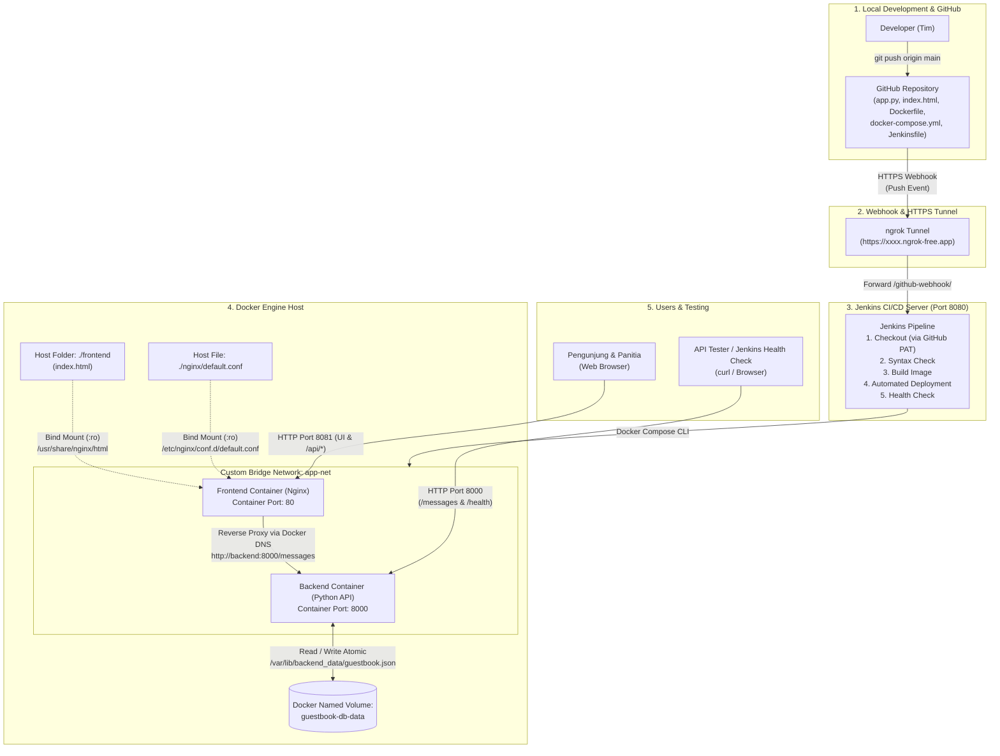

# Product Requirements Document (PRD) & Desain Sistem
## Studi Kasus 1: Buku Tamu Digital Kampus (*Digital Guestbook*)

---

## 1. Informasi Dokumen & Identitas Proyek

| Atribut | Detail Informasi |
|---|---|
| **Mata Kuliah** | Cloud Computing — Ujian Tengah Semester (Ujian Chunin) |
| **Dosen Pengampu** | CSO |
| **Studi Kasus** | **No. 1 — Buku Tamu Digital Kampus (*Digital Guestbook*)** |
| **Arsitektur Utama** | Cloud-Native Fullstack Application (Python REST API + Vanilla JS/Nginx) & Automated CI/CD Pipeline (Docker, Compose, Jenkins, GitHub Webhook, ngrok) |
| **Anggota Kelompok** | 1. `[Nama Lengkap 1 — NIM]`<br>2. `[Nama Lengkap 2 — NIM]`<br>3. `[Nama Lengkap 3 — NIM]`<br>4. `[Nama Lengkap 4 — NIM (Opsional)]` |
| **Status Dokumen** | Final Blueprint — Siap Implementasi (MVP) |
| **Referensi Utama** | `Cloud_computing_chunin_exam.pdf` (Hal. 1–3) & Diagram `ci-cd.jpeg` |

---

## 2. Latar Belakang, Masalah, dan Tujuan

### 2.1 Latar Belakang & Pernyataan Masalah
Dalam berbagai kegiatan akademik dan kemahasiswaan di kampus (seminar, workshop, kuliah umum, pameran laboratorium, maupun kunjungan instansi luar), pencatatan kehadiran tamu yang masih menggunakan buku fisik sering menimbulkan kendala:
1. Antrean panjang di meja registrasi karena pencatatan manual.
2. Data sulit direkapitulasi secara *real-time* oleh panitia acara.
3. Entri yang salah tulis sulit dihapus/dirapikan tanpa mencoret buku fisik.
4. Risiko kehilangan data apabila perangkat aplikasi mengalami gangguan atau *restart* jika tidak memiliki arsitektur penyimpanan persisten (*persistent storage*).

### 2.2 Tujuan Proyek
Membangun **Buku Tamu Digital Kampus** berbasis web yang ringan, responsif, dan terisolasi di dalam kontainer Docker, dengan tujuan teknis dan fungsional:
1. **Fungsionalitas CRUD Inti**: Menyediakan antarmuka web bagi pengunjung untuk mengisi buku tamu (`POST /messages`), menampilkan daftar tamu secara *real-time* tanpa *reload* halaman manual (`GET /messages`), serta memungkinkan panitia menghapus entri yang keliru (`DELETE /messages?index=X`).
2. **Data Immunity (Persistensi Data)**: Menjamin seluruh data tamu tersimpan di dalam file `guestbook.json` pada **Docker Named Volume (`guestbook-db-data`)**, sehingga data tetap utuh (tidak hilang) meskipun kontainer backend dihapus paksa (`docker rm -f`).
3. **Live UI Development (Bind Mount)**: Memisahkan layanan frontend menggunakan web server **Nginx** dengan **Bind Mount** ke direktori host lokal agar perubahan kode HTML/CSS/JS langsung terlihat di browser tanpa perlu melakukan *rebuild* Docker image.
4. **Isolasi Jaringan (Custom Bridge Network)**: Menghubungkan kontainer Frontend dan Backend di dalam jaringan terisolasi **`app-net`** menggunakan resolusi DNS internal Docker (*Service Name*).
5. **Automated CI/CD Pipeline**: Mengotomatisasi proses pengujian sintaks, pembuatan *image*, *deployment*, dan *health check* menggunakan **Jenkins Declarative Pipeline**, **GitHub PAT**, **GitHub Webhook**, dan **ngrok HTTPS Tunnel**.

### 2.3 Target Indikator Keberhasilan (KPI & Rubrik UTS)
| Komponen Rubrik | Bobot | Target Pencapaian (Skor Maksimal 85–100) |
|---|---|---|
| **1. Backend Python API** | **20%** | Fitur `GET`, `POST`, `DELETE` pada `/messages` + `GET /health` berjalan lengkap, respons JSON terstandar, dan *error handling* HTTP `400`/`404`/`500` presisi. |
| **2. Frontend HTML & JS** | **15%** | UI bersih dan modern, komunikasi asinkron `fetch()` lancar, pembaruan tabel & tombol *Delete* bekerja *real-time* tanpa *refresh* halaman manual. |
| **3. Docker & Storage Config** | **25%** | Named Volume `guestbook-db-data` terbukti menjaga data saat `docker rm -f` dijalankan (*Data Immunity*), Bind Mount frontend berfungsi, dan terisolasi di `app-net`. |
| **4. Jenkins CI/CD Pipeline** | **25%** | `Jenkinsfile` sukses mengeksekusi 5 *stage* (*Checkout, Syntax Check, Build Image, Automated Deployment, Health Check*) secara otomatis via Webhook GitHub + ngrok. |
| **5. Dokumentasi & Demo** | **15%** | `README.md` lengkap dengan diagram arsitektur, petunjuk instalasi, serta video demo 5–8 menit yang mendemonstrasikan UI/API, *Data Immunity*, dan *auto-deploy*. |

---

## 3. Pengguna Sistem & Ruang Lingkup (Scope)

### 3.1 Persona Pengguna
| Persona | Peran | Kebutuhan Utama |
|---|---|---|
| **Tamu / Pengunjung Kampus** | Pengisi buku tamu | Mengisi Nama Lengkap, Asal Instansi/Universitas, dan Keperluan Kunjungan dengan cepat dan mudah. |
| **Panitia Acara / Resepsionis** | Pengelola daftar hadir | Memantau daftar tamu yang hadir secara langsung, melihat total kunjungan, dan menghapus entri yang salah/duplikat. |
| **Tim DevOps / Dosen Penguji** | Evaluator sistem | Menguji ketahanan data (*container dismantle test*), kecepatan perubahan UI via *bind mount*, dan otomatisasi *pipeline* CI/CD. |

> **Catatan Batasan Akses (MVP)**: Sesuai spesifikasi tugas yang berfokus 100% pada arsitektur *containerization* dan *DevOps*, aplikasi tidak menerapkan sistem autentikasi/login. Seluruh fitur baca, tambah, dan hapus diakses pada satu halaman dashboard terpadu menggunakan data simulasi/fiktif saat demonstrasi.

### 3.2 Ruang Lingkup Fitur (In-Scope vs Out-of-Scope)
* **In-Scope (Wajib pada MVP)**:
  * REST API Python (`app.py`) dengan pustaka standar (`http.server`, `json`, `urllib.parse`, `uuid`, `datetime`, `threading`) tanpa *framework* berat.
  * Endpoint `GET /messages`, `POST /messages`, `DELETE /messages?index=X`, dan `GET /health`.
  * Penyimpanan persisten `guestbook.json` di `/var/lib/backend_data/guestbook.json` menggunakan Docker Named Volume `guestbook-db-data`.
  * Frontend `index.html` (HTML5, CSS3 modern, Vanilla JavaScript `fetch()`) di atas kontainer Nginx (`nginx:alpine`) dengan *Bind Mount*.
  * Konfigurasi Reverse Proxy Nginx (`default.conf`) yang meneruskan *request* dari frontend ke `http://backend:8000` via Docker Service Name di jaringan `app-net`.
  * Orkestrasi multi-kontainer deklaratif melalui `docker-compose.yml`.
  * Pipeline otomatisasi `Jenkinsfile` (5 *Stages*) yang terintegrasi dengan GitHub Webhook (via *ngrok tunnel*) dan GitHub Personal Access Token (PAT).
* **Out-of-Scope (Di Luar MVP)**:
  * Autentikasi/otorisasi pengguna (Login/RBAC).
  * Endpoint edit/update (`PUT`/`PATCH`) — sesuai spesifikasi PDF yang hanya mewajibkan `GET`, `POST`, dan `DELETE`.
  * Database relasional/eksternal (MySQL, PostgreSQL, MongoDB, SQLite).
  * Orkestrasi tingkat lanjut seperti Kubernetes/Docker Swarm.

---

## 4. Kebutuhan Fungsional & Non-Fungsional

### 4.1 Kebutuhan Fungsional (*Functional Requirements*)
| Kode | Fitur | Deskripsi Kebutuhan | Kriteria Penerimaan (*Acceptance Criteria*) |
|---|---|---|---|
| **FR-01** | **Tampil Daftar Tamu (`GET`)** | Sistem menampilkan seluruh daftar tamu beserta total jumlah kunjungan saat halaman dibuka. | Browser memanggil `GET /api/messages` (atau `GET /messages`), menampilkan tabel tamu atau pesan *empty state* jika belum ada data, dengan status `200 OK`. |
| **FR-02** | **Tambah Entri Tamu (`POST`)** | Pengunjung dapat mengirimkan data Nama, Instansi, dan Keperluan melalui formulir buku tamu. | Data valid dikirim via `POST /api/messages`, backend menyimpan ke `guestbook.json`, mengembalikan `201 Created`, form dikosongkan, dan tabel diperbarui tanpa *reload* browser. |
| **FR-03** | **Validasi Input & Payload** | Sistem menolak input kosong, hanya berisi spasi, tipe data salah, atau melebihi batas karakter. | Jika `name`, `institution`, atau `purpose` kosong/tidak valid, atau body bukan JSON objek valid, backend menolak dengan status `400 Bad Request` dan pesan error JSON yang jelas. |
| **FR-04** | **Hapus Entri Tamu (`DELETE`)** | Panitia dapat menghapus entri tamu tertentu berdasarkan urutan indeks data (`index=X`). | Saat tombol Hapus diklik dan dikonfirmasi, frontend memanggil `DELETE /api/messages?index=X`, backend menghapus elemen ke-`X` di `guestbook.json`, mengembalikan `200 OK`, dan tabel diperbarui *real-time*. |
| **FR-05** | **Penanganan Indeks & Route Error** | Sistem menangani parameter `index` yang tidak valid atau di luar jangkauan serta *endpoint* yang tidak dikenal. | Jika `index` hilang, negatif, atau bukan angka → `400 Bad Request`. Jika `index >= total_data` atau *route* tidak ada → `404 Not Found`. |
| **FR-06** | **Health Check (`GET /health`)** | Sistem menyediakan *endpoint* pemeriksaan kesehatan layanan untuk Jenkins dan Docker. | `GET /health` memeriksa kesiapan direktori/file volume dan mengembalikan `200 OK` dengan payload `{"status": "UP", ...}`. |

### 4.2 Kebutuhan Non-Fungsional & Infrastruktur (*Non-Functional Requirements*)
| Kode | Kategori | Spesifikasi Teknis |
|---|---|---|
| **NFR-01** | **Data Immunity (Persistensi)** | File `/var/lib/backend_data/guestbook.json` wajib berada di Docker Named Volume `guestbook-db-data`. Penghapusan kontainer (`docker rm -f`) tidak boleh menghapus data tamu. |
| **NFR-02** | **Atomicity & Concurrency** | Operasi tulis (`POST` dan `DELETE`) wajib menggunakan `threading.Lock()` serta teknik *atomic file replacement* (tulis ke file sementara `.tmp` lalu `os.replace()`) agar file JSON tidak korup. |
| **NFR-03** | **Live Reload UI (Bind Mount)** | Folder frontend pada host dipasang secara *bind mount* ke `/usr/share/nginx/html` pada kontainer Nginx sehingga perubahan `index.html` langsung tampil saat browser di-*refresh*. |
| **NFR-04** | **Network Isolation & DNS** | Kontainer `frontend` dan `backend` terhubung di *Custom Bridge Network* `app-net`. Komunikasi *proxy* dari Nginx ke Python wajib menggunakan nama servis `http://backend:8000`. |
| **NFR-05** | **Keamanan Render UI (XSS)** | Frontend wajib merender seluruh teks input (`name`, `institution`, `purpose`) menggunakan `textContent` (atau *HTML escaping*) dan dilarang menyisipkan input mentah ke `innerHTML`. |
| **NFR-06** | **Zero-Secret in Codebase** | GitHub Personal Access Token (PAT) hanya boleh disimpan di **Jenkins Credentials Store** dan tidak boleh ditulis (*hardcode*) di dalam kode, `Dockerfile`, maupun `Jenkinsfile`. |

---

## 5. Desain Arsitektur Sistem & Infrastruktur

### 5.1 Diagram Arsitektur Fullstack & CI/CD End-to-End
Diagram berikut mengintegrasikan arsitektur kontainer aplikasi (sesuai `Cloud_computing_chunin_exam.pdf`) dengan alur otomatisasi CI/CD menggunakan **GitHub Webhook + ngrok + Jenkins** (sesuai `ci-cd.jpeg`):



### 5.2 Strategi Port & Komunikasi Antar-Kontainer (Penting!)
Mengacu pada diagram `ci-cd.jpeg`, server **Jenkins** berjalan menggunakan port **`8080`** (yang diekspos melalui `ngrok http 8080`). Agar tidak terjadi **konflik port (*port collision*)** di mesin host yang sama, pembagian port dirancang sebagai berikut:

| Layanan / Komponen | Nama Kontainer / Servis | Port Internal | Port Host | Keterangan Akses |
|---|---|---|---|---|
| **Jenkins Server** | Host / Jenkins Service | `8080` | `8080` | Diakses lokal di `http://localhost:8080` dan diekspos ke GitHub Webhook via `ngrok http 8080`. |
| **Frontend (Nginx)** | `frontend` (`guestbook-frontend`) | `80` | **`8081`** *(atau dapat diubah via env)* | Diakses pengguna di `http://localhost:8081`. Menyajikan `index.html` dan meneruskan `/api/*` ke `http://backend:8000/*`. |
| **Backend (Python API)** | `backend` (`guestbook-backend`) | `8000` | **`8000`** | Diakses internal oleh Nginx via `http://backend:8000` (DNS `app-net`) serta dapat diuji langsung via `http://localhost:8000/messages` & `http://localhost:8000/health` sesuai `ci-cd.jpeg`. |

> **Mengapa Menggunakan Nginx Reverse Proxy sekaligus Mengekspos Port 8000?**
> 1. **Memenuhi Syarat DNS Docker (`app-net`)**: Saat pengguna membuka UI di `http://localhost:8081`, JavaScript memanggil `/api/messages`. Nginx di dalam kontainer `frontend` meneruskan permintaan tersebut ke `http://backend:8000/messages` menggunakan **Service Name (`backend`)** di dalam jaringan terisolasi `app-net` (bebas masalah CORS di browser).
> 2. **Memenuhi Diagram `ci-cd.jpeg` & Kemudahan Pengujian API**: Dengan tetap memetakan port `8000:8000` (serta menyertakan header CORS pada Python API), dosen penguji dan *stage Health Check* Jenkins juga dapat mengakses `http://localhost:8000/messages` dan `http://localhost:8000/health` secara langsung menggunakan `curl` atau Postman.

---

## 6. Struktur Repositori & Spesifikasi Konfigurasi

### 6.1 Struktur Direktori Repositori GitHub
Sesuai *Deliverables* pada panduan ujian (memuat `app.py`, `index.html`, `Dockerfile`, `docker-compose.yml`, `Jenkinsfile`, dan `README.md`), berikut adalah tata letak repositori yang bersih dan terstruktur:

```text
.
├── app.py                      # Backend Python REST API (tanpa framework berat)
├── index.html                  # Frontend UI (Plain HTML5, CSS3, Vanilla JS fetch API)
├── nginx/
│   └── default.conf            # Konfigurasi Nginx Reverse Proxy ke http://backend:8000
├── Dockerfile                  # Definisi image untuk layanan Backend Python
├── docker-compose.yml          # Definisi deklaratif Services, Named Volume, Bind Mount, & app-net
├── Jenkinsfile                 # Skrip Declarative Pipeline 5 Stage
├── README.md                   # Dokumentasi utama, diagram arsitektur, & panduan instalasi
└── docs/
    ├── 01-prd-desain-sistem.md # Dokumen PRD & Desain Sistem (dokumen ini)
    ├── 02-skema-database.md    # Dokumen Skema Penyimpanan JSON & Volume
    ├── 03-user-flow.md         # Dokumen User Flow, Wireframe UI, & Sequence Diagram
    └── ci-cd.jpeg              # Diagram referensi arsitektur CI/CD
```
*(Catatan: Jika tim memilih menempatkan `app.py` di `./backend/app.py` dan `index.html` di `./frontend/index.html`, sesuaikan path `build.context` dan `volumes` pada `docker-compose.yml`. Menempatkan `app.py` dan `index.html` di root atau subfolder sama-sama valid selama path di `docker-compose.yml` dan `Jenkinsfile` konsisten).*

### 6.2 Rancangan Konfigurasi `docker-compose.yml`
```yaml
services:
  backend:
    build:
      context: .
      dockerfile: Dockerfile
    container_name: guestbook-backend
    restart: unless-stopped
    ports:
      - "8000:8000"
    environment:
      - DATA_DIR=/var/lib/backend_data
      - DATA_FILE=/var/lib/backend_data/guestbook.json
      - PORT=8000
    volumes:
      - guestbook-db-data:/var/lib/backend_data
    networks:
      - app-net
    healthcheck:
      test: ["CMD", "python3", "-c", "import urllib.request; urllib.request.urlopen('http://localhost:8000/health')"]
      interval: 10s
      timeout: 5s
      retries: 3

  frontend:
    image: nginx:alpine
    container_name: guestbook-frontend
    restart: unless-stopped
    ports:
      - "8081:80"
    volumes:
      - ./index.html:/usr/share/nginx/html/index.html:ro
      - ./nginx/default.conf:/etc/nginx/conf.d/default.conf:ro
    depends_on:
      - backend
    networks:
      - app-net

volumes:
  guestbook-db-data:
    name: guestbook-db-data

networks:
  app-net:
    name: app-net
    driver: bridge
```

### 6.3 Rancangan Konfigurasi Reverse Proxy Nginx (`nginx/default.conf`)
```nginx
server {
    listen 80;
    server_name localhost;

    root /usr/share/nginx/html;
    index index.html;

    # Layani file statis Frontend (Bind Mount)
    location / {
        try_files $uri $uri/ /index.html;
        add_header Cache-Control "no-store, no-cache, must-revalidate";
    }

    # Proxy request API dari Frontend ke kontainer Backend via Docker DNS (app-net)
    location /api/ {
        proxy_pass http://backend:8000/;
        proxy_http_version 1.1;
        proxy_set_header Host $host;
        proxy_set_header X-Real-IP $remote_addr;
        proxy_set_header X-Forwarded-For $proxy_add_x_forwarded_for;
    }
}
```

---

## 7. Spesifikasi Kontrak REST API

Seluruh respons API menggunakan header `Content-Type: application/json; charset=utf-8` serta mendukung CORS (`Access-Control-Allow-Origin: *`, `Access-Control-Allow-Methods: GET, POST, DELETE, OPTIONS`, `Access-Control-Allow-Headers: Content-Type`).
> **Catatan Endpoint**: Melalui Nginx (`:8081`), frontend memanggil `/api/messages` yang diteruskan ke `/messages` pada backend (`:8000`). Jika diakses langsung ke backend (`:8000`), path yang digunakan adalah `/messages`.

### 7.1 Ringkasan Endpoint
| Method | Endpoint Backend (`:8000`) | Endpoint via Nginx (`:8081`) | Deskripsi | Kode Sukses | Kode Error |
|---|---|---|---|---|---|
| `GET` | `/messages` | `/api/messages` | Mengambil seluruh daftar tamu beserta indeks dan jumlah total. | `200 OK` | `500` |
| `POST` | `/messages` | `/api/messages` | Menambahkan entri tamu baru ke `guestbook.json`. | `201 Created` | `400`, `413`, `415`, `500` |
| `DELETE` | `/messages?index=X` | `/api/messages?index=X` | Menghapus satu entri tamu pada posisi indeks ke-`X` (berbasis 0). | `200 OK` | `400`, `404`, `500` |
| `GET` | `/health` | `/api/health` | Memeriksa status kesehatan server dan ketersediaan volume data. | `200 OK` | `500` |

### 7.2 Detail Kontrak per Endpoint

#### A. `GET /messages` — Ambil Daftar Tamu
* **Response `200 OK` (Saat ada data)**:
```json
{
  "status": "success",
  "total": 2,
  "messages": [
    {
      "index": 0,
      "id": "d7ad0a26-2090-4cb4-9e81-d398d819d7d0",
      "name": "Budi Santoso",
      "institution": "Telkom University",
      "purpose": "Menghadiri Seminar Cloud Computing & DevOps",
      "created_at": "2026-10-31T02:30:00Z"
    },
    {
      "index": 1,
      "id": "9c66579b-3da2-4bab-b2ac-69f5d0eb2f84",
      "name": "Siti Aminah",
      "institution": "PT Tekno Nusantara",
      "purpose": "Kunjungan Industri Laboratorium Cloud",
      "created_at": "2026-10-31T02:45:12Z"
    }
  ]
}
```
* **Response `200 OK` (Saat daftar kosong)**:
```json
{
  "status": "success",
  "total": 0,
  "messages": []
}
```

#### B. `POST /messages` — Tambah Entri Tamu Baru
* **Request Headers**: `Content-Type: application/json`
* **Request Body**:
```json
{
  "name": "Budi Santoso",
  "institution": "Telkom University",
  "purpose": "Menghadiri Seminar Cloud Computing & DevOps"
}
```
* **Aturan Validasi Input**:
  * `name`: Wajib, string (setelah `strip()`), panjang `1–100` karakter.
  * `institution`: Wajib, string (setelah `strip()`), panjang `1–150` karakter (isi `"Umum"` bila tidak mewakili instansi).
  * `purpose`: Wajib, string (setelah `strip()`), panjang `1–300` karakter.
  * `id` (UUID v4) dan `created_at` (UTC ISO 8601) dibuat otomatis oleh backend.
* **Response `201 Created`**:
```json
{
  "status": "success",
  "message": "Entri buku tamu berhasil ditambahkan.",
  "data": {
    "index": 0,
    "id": "d7ad0a26-2090-4cb4-9e81-d398d819d7d0",
    "name": "Budi Santoso",
    "institution": "Telkom University",
    "purpose": "Menghadiri Seminar Cloud Computing & DevOps",
    "created_at": "2026-10-31T02:30:00Z"
  }
}
```

#### C. `DELETE /messages?index=X` — Hapus Entri Tamu
* **Query Parameter**: `index` (Wajib, bilangan bulat non-negatif `0, 1, 2, ...` sesuai posisi elemen di dalam array saat ini).
* **Response `200 OK`**:
```json
{
  "status": "success",
  "message": "Entri tamu pada index 0 berhasil dihapus.",
  "deleted": {
    "id": "d7ad0a26-2090-4cb4-9e81-d398d819d7d0",
    "name": "Budi Santoso",
    "institution": "Telkom University",
    "purpose": "Menghadiri Seminar Cloud Computing & DevOps",
    "created_at": "2026-10-31T02:30:00Z"
  },
  "total": 1
}
```

#### D. `GET /health` — Health Check Endpoint
* **Response `200 OK`**:
```json
{
  "status": "UP",
  "service": "guestbook-backend",
  "storage_path": "/var/lib/backend_data/guestbook.json",
  "storage_writable": true,
  "total_entries": 1
}
```

#### E. Standar Format Respons Error (`400`, `404`, `405`, `413`, `415`, `500`)
```json
{
  "status": "error",
  "error": {
    "code": "VALIDATION_ERROR",
    "message": "Field 'name' wajib diisi dan harus berupa teks (1-100 karakter)."
  }
}
```
| HTTP Status | Kode Error (`error.code`) | Kondisi Pemicu |
|---|---|---|
| `400 Bad Request` | `INVALID_JSON` / `VALIDATION_ERROR` / `INVALID_INDEX` | JSON rusak, body bukan objek JSON, field wajib kosong/terlalu panjang, atau parameter `index` kosong/negatif/bukan integer (misal `?index=abc` atau `?index=-1`). |
| `404 Not Found` | `INDEX_OUT_OF_RANGE` / `ROUTE_NOT_FOUND` | Nilai `index` >= jumlah data saat ini, atau URL endpoint tidak terdaftar. |
| `405 Method Not Allowed` | `METHOD_NOT_ALLOWED` | HTTP method selain `GET`, `POST`, `DELETE`, `OPTIONS` dipanggil pada `/messages`. |
| `413 Payload Too Large` | `PAYLOAD_TOO_LARGE` | Ukuran body `POST` melebihi batas aman (16 KiB). |
| `415 Unsupported Media Type` | `UNSUPPORTED_MEDIA_TYPE` | Request `POST` tidak menyertakan header `Content-Type: application/json`. |
| `500 Internal Server Error` | `STORAGE_ERROR` | Gagal membaca/menulis file `/var/lib/backend_data/guestbook.json` atau format JSON di dalam volume rusak. |

---

## 8. Rancangan Otomatisasi CI/CD (Jenkins, GitHub PAT, Webhook, & ngrok)

Sesuai spesifikasi pada `Cloud_computing_chunin_exam.pdf` (Bagian 2.4 & 4) serta arsitektur pada `ci-cd.jpeg`:

### 8.1 Alur Integrasi GitHub Webhook & ngrok
1. **Pembuatan GitHub PAT**:
   * Masuk ke **GitHub Settings → Developer settings → Personal access tokens → Tokens (classic)**.
   * Buat token dengan *Note*: `Jenkins CI/CD UTS Token`, *Expiration*: `30/90 days`, dan centang izin **`repo`** serta **`admin:repo_hook`**.
   * Simpan token di **Jenkins → Manage Jenkins → Credentials → System → Global credentials** (Kind: *Username with password*, ID: `github-pat-credential`).
2. **Ekspos Jenkins Lokal via ngrok**:
   * Jalankan `ngrok http 8080` pada mesin tempat Jenkins berjalan untuk mendapatkan URL publik HTTPS (contoh: `https://xxxx.ngrok-free.app`).
3. **Konfigurasi GitHub Webhook**:
   * Pada repositori GitHub → **Settings → Webhooks → Add webhook**:
     * **Payload URL**: `https://xxxx.ngrok-free.app/github-webhook/`
     * **Content type**: `application/json`
     * **Trigger**: *Just the `push` event*.
4. **Konfigurasi Pipeline Job di Jenkins**:
   * Buat item *Pipeline*, aktifkan trigger **GitHub hook trigger for GITScm polling**, pilih **Pipeline script from SCM (Git)** dengan URL repositori GitHub, *Credentials* `github-pat-credential`, branch `*/main`, dan *Script Path* `Jenkinsfile`.

### 8.2 Spesifikasi 5 Stage pada Declarative `Jenkinsfile`
| Stage | Nama Stage | Aksi & Perintah Utama | Kriteria Lulus Stage |
|---|---|---|---|
| **Stage 1** | `Checkout` | Mengambil kode terbaru dari branch `main` menggunakan kredensial GitHub PAT (`checkout scm`). | Kode sumber terbaru berhasil diunduh ke workspace Jenkins. |
| **Stage 2** | `Syntax Check` | 1. Validasi sintaks Python: `python3 -m py_compile app.py`<br>2. Validasi struktur file HTML keberadaan tag utama<br>3. Validasi konfigurasi Docker Compose: `docker compose config -q` | Tidak ada *syntax error* pada kode Python maupun YAML Compose. |
| **Stage 3** | `Build Image` | Membangun *Docker image* terbaru untuk layanan backend: `docker compose build --pull backend` | Image `backend` berhasil dibangun tanpa error. |
| **Stage 4** | `Automated Deployment` | Menjalankan pembaruan kontainer secara deklaratif tanpa menghapus *Named Volume*: `docker compose up -d --remove-orphans` | Kontainer `guestbook-backend` dan `guestbook-frontend` berstatus *Up/Running*; volume `guestbook-db-data` tetap terjaga. |
| **Stage 5** | `Health Check` | Menunggu kesiapan layanan (retry s.d. 5 kali) lalu menguji:<br>1. `curl -fsS http://localhost:8000/health`<br>2. `curl -fsS http://localhost:8000/messages`<br>3. `curl -fsSI http://localhost:8081/` | Seluruh *endpoint* mengembalikan HTTP `200 OK` dan JSON valid. Jika gagal setelah batas *retry*, pipeline ditandai *FAILED*. |

> **Catatan Penting Bind Mount saat Deployment oleh Jenkins**:
> Jika Jenkins dijalankan di dalam kontainer Docker namun menggunakan *Docker socket host* (`/var/run/docker.sock`), pastikan perintah `docker compose up -d` dijalankan dari direktori path yang dikenali oleh *Docker Host* (atau sinkronkan file repositori ke direktori deployment host yang tetap) agar *bind mount* `./index.html` dan `./nginx/default.conf` terpasang dengan benar dan bukan direktori kosong.

---

## 9. Rencana Pengujian & Skenario Demo Video (5–8 Menit)

### 9.1 Matriks Pengujian Sistem
| Kode Uji | Skenario Pengujian | Langkah Eksekusi | Ekspektasi Hasil |
|---|---|---|---|
| **TC-01** | **Read Empty & List (`GET`)** | Buka `http://localhost:8081` saat volume baru dibuat. | Tampil pesan *"Belum ada tamu terdaftar"* dan total `0` tanpa error di *console*. |
| **TC-02** | **Create Valid (`POST`)** | Isi Nama, Instansi, Keperluan lalu klik **Simpan Buku Tamu**. | Status `201 Created`, muncul notifikasi sukses, form bersih, dan baris baru langsung tampil di tabel tanpa *refresh* halaman. |
| **TC-03** | **Validasi Error (`400`)** | Kirim form dengan field kosong atau kirim request `POST` dengan JSON tidak valid via `curl`. | Ditolak dengan HTTP `400 Bad Request` dan pesan kesalahan yang informatif. |
| **TC-04** | **Delete Valid (`DELETE`)** | Klik tombol **Hapus** pada salah satu baris tamu dan konfirmasi dialog. | Status `200 OK`, baris terhapus secara *real-time*, dan indeks baris sisanya diperbarui otomatis. |
| **TC-05** | **Delete Out of Range (`404`)** | Panggil `curl -X DELETE "http://localhost:8000/messages?index=999"`. | Ditolak dengan HTTP `404 Not Found` (`INDEX_OUT_OF_RANGE`). |
| **TC-06** | **Simulasi Data Immunity (25% Rubrik)** | 1. Tambah 2 data tamu.<br>2. Hapus paksa kontainer backend: `docker rm -f guestbook-backend`<br>3. Nyalakan kembali: `docker compose up -d backend`<br>4. Refresh halaman / panggil `GET /messages`. | Kedua data tamu **tetap ada dan utuh** karena tersimpan di *Named Volume* `guestbook-db-data`. |
| **TC-07** | **Uji Live Bind Mount UI** | Ubah subjudul pada file `index.html` di host lokal, simpan, lalu *refresh* browser (`F5`). | Perubahan tampilan langsung terlihat di browser **tanpa** menjalankan `docker build` atau `docker compose up --build`. |
| **TC-08** | **Simulasi CI/CD Webhook (25% Rubrik)** | Ubah kode/teks, lakukan `git commit` dan `git push origin main`. | GitHub mengirim webhook via *ngrok* → Jenkins otomatis menjalankan 5 *stage* hingga hijau (*Success*) → perubahan langsung aktif di aplikasi. |

### 9.2 Alur Presentasi & Video Demo (Durasi 5–8 Menit)
1. **Menit 0:00 – 1:00 (Pembukaan & Arsitektur)**: Perkenalan anggota kelompok (Nama & NIM), penjelasan Studi Kasus 1 (Buku Tamu Digital Kampus), dan penjelasan singkat diagram arsitektur Docker (`app-net`, `guestbook-db-data`, *bind mount*) serta CI/CD (`ci-cd.jpeg`).
2. **Menit 1:00 – 2:30 (Demo UI & API CRUD)**: Demonstrasi `GET /messages`, pengisian form tamu baru (`POST /messages`), validasi input, dan penghapusan entri (`DELETE /messages?index=X`) secara *real-time* tanpa *refresh* manual, serta demonstrasi perubahan langsung UI melalui *Bind Mount*.
3. **Menit 2:30 – 4:30 (Simulasi Data Immunity)**: Menunjukkan isi buku tamu saat ini, menjalankan `docker rm -f guestbook-backend` di terminal untuk menghancurkan kontainer backend, menjalankan kembali `docker compose up -d`, dan membuktikan di browser bahwa seluruh data di `guestbook.json` dalam volume `guestbook-db-data` tetap aman 100%.
4. **Menit 4:30 – 7:30 (Simulasi CI/CD Otomatis)**: Menunjukkan konfigurasi GitHub PAT, ngrok tunnel, dan Webhook GitHub; melakukan perubahan kode lalu `git push origin main`; memperlihatkan *dashboard* Jenkins yang otomatis ter-trigger dan mengeksekusi ke-5 *stage* (*Checkout, Syntax Check, Build Image, Automated Deployment, Health Check*) hingga selesai dan menampilkan hasilnya di browser.

---

## 10. Pembagian Tugas Kelompok (*Team Roles*)

| Peran | Tanggung Jawab Utama | Deliverables Terkait |
|---|---|---|
| **Anggota 1 — Backend & Storage Engineer** | Mengembangkan `app.py` (REST API `GET`, `POST`, `DELETE`, `/health`), validasi input, *atomic JSON file storage*, dan `Dockerfile`. | `app.py`, `Dockerfile`, `02-skema-database.md` |
| **Anggota 2 — Frontend & UX Engineer** | Mengembangkan `index.html` (UI/UX responsif, `fetch()` API asinkron, state handling, modal konfirmasi hapus) dan konfigurasi proxy Nginx. | `index.html`, `nginx/default.conf`, `03-user-flow.md` |
| **Anggota 3 — DevOps & Cloud Infrastructure** | Merancang `docker-compose.yml` (`app-net`, `guestbook-db-data`, *bind mount*), `Jenkinsfile` 5 *stage*, integrasi GitHub PAT, Webhook, dan *ngrok*. | `docker-compose.yml`, `Jenkinsfile` |
| **Anggota 4 / Bersama — QA & Dokumentasi** | Menyusun `README.md`, menguji seluruh skenario rubrik (API, *Data Immunity*, CI/CD), dan mengoordinasikan perekaman video demo 5–8 menit. | `README.md`, `01-prd-desain-sistem.md`, Video Demo |
