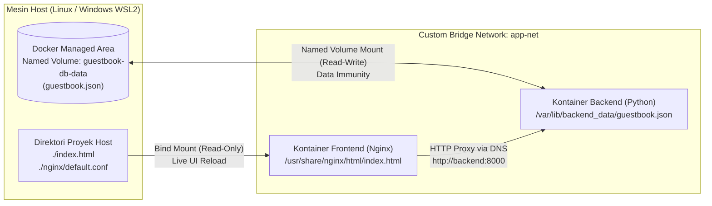
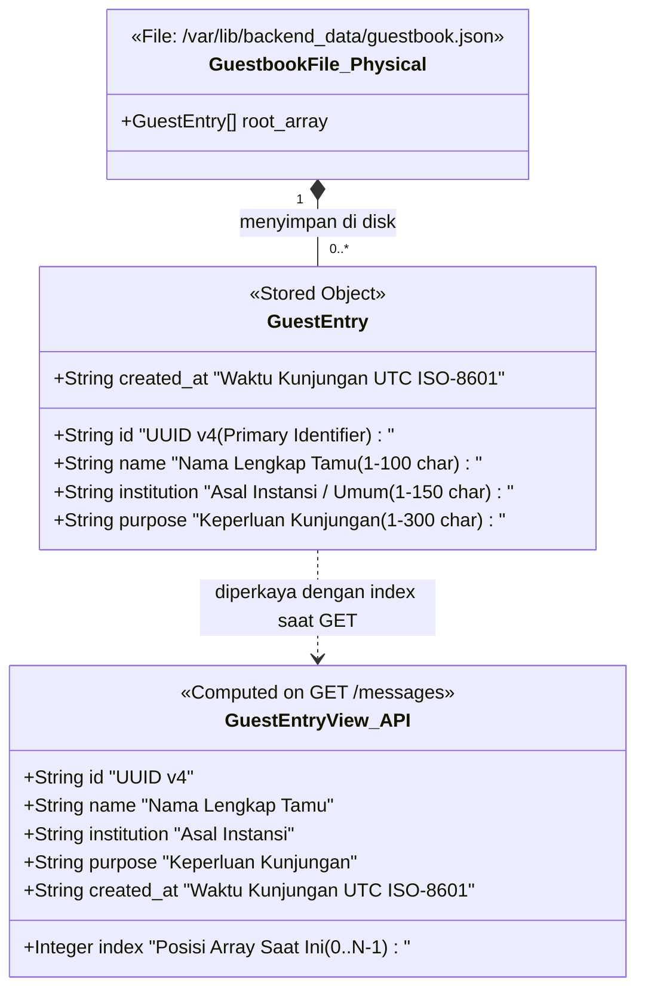
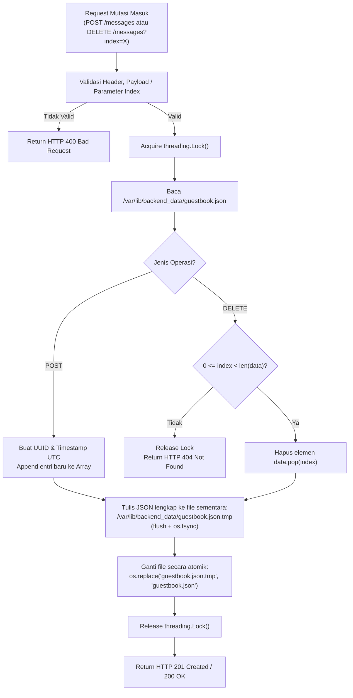

# Dokumentasi Skema Database & Penyimpanan Persisten
## Studi Kasus 1: Buku Tamu Digital Kampus (*Digital Guestbook*)

---

## 1. Arsitektur Penyimpanan (*Storage Architecture*)

Sesuai dengan spesifikasi wajib pada **Panduan Ujian Chunin (Studi Kasus No. 1)**, aplikasi **tidak menggunakan** RDBMS/NoSQL eksternal (seperti MySQL, PostgreSQL, SQLite, atau MongoDB), melainkan menggunakan **penyimpanan berbasis file JSON (`guestbook.json`)** yang diisolasi di dalam **Docker Named Volume (`guestbook-db-data`)**.

### 1.1 Mengapa Wajib Menggunakan Docker Named Volume (Bukan Bind Mount)?
Berdasarkan **Rubrik Penilaian UTS Komponen 3 (Bobot 25%)**:
> *"Sangat Baik (85–100): Named Volume terbukti menjaga data saat kontainer di-dismantle (`docker rm -f`), Bind Mount berfungsi. Cukup (70–84): Storage berfungsi tetapi salah menerapkan jenis volume (misal: DB pakai Bind Mount)."*

Oleh karena itu, sistem ini menerapkan pemisahan jenis *storage* secara tegas:
1. **Database (`guestbook.json`) → Docker Named Volume (`guestbook-db-data`)**: Dikelola sepenuhnya oleh Docker Engine di area terisolasi host (`/var/lib/docker/volumes/guestbook-db-data/_data`), terlepas dari siklus hidup kontainer backend, dan aman dari penghapusan tidak sengaja di direktori kerja *source code*.
2. **UI Statis (`index.html`) → Docker Bind Mount (`./index.html:/usr/share/nginx/html/index.html:ro`)**: Dipetakan langsung dari folder kerja *host* ke kontainer Nginx agar perubahan tampilan oleh *developer* langsung terlihat tanpa perlu *rebuild image*.



### 1.2 Ringkasan Parameter Penyimpanan
| Parameter | Spesifikasi Teknis |
|---|---|
| **Nama File Database** | `guestbook.json` |
| **Nama Docker Volume** | `guestbook-db-data` (Deklaratif di `docker-compose.yml`) |
| **Mount Path di Kontainer** | `/var/lib/backend_data` |
| **Full Path File di Kontainer** | `/var/lib/backend_data/guestbook.json` |
| **Format & Encoding** | JSON (*JavaScript Object Notation*), UTF-8, indentasi 2 spasi |
| **Struktur Root JSON** | Array of Objects (`[ {...}, {...} ]`) |
| **Nilai Default / Inisialisasi** | Array kosong `[]` (dibuat otomatis saat kontainer pertama kali dijalankan) |
| **Mekanisme Keamanan Tulis** | In-process `threading.Lock()` + *Atomic Temp-File Swap* (`os.replace`) |

---

## 2. Pemodelan Data & Struktur Entitas

Meskipun disimpan dalam satu file JSON (`guestbook.json`), setiap elemen di dalam array merepresentasikan satu entitas **`GuestEntry`** (catatan kunjungan tamu). Satu orang pengunjung yang sama diperbolehkan mengisi buku tamu lebih dari satu kali pada waktu atau keperluan yang berbeda karena setiap objek mencatat **kejadian kunjungan (*visit log*)**, bukan akun pengguna.

### 2.1 Diagram Struktur Data (Penyimpanan Fisik vs Representasi Respons API)


---

## 3. Kamus Data (*Data Dictionary*) & Aturan Validasi

### 3.1 Spesifikasi Field pada `GuestEntry`
| Nama Field | Tipe Data | Disimpan di Disk? | Sumber Nilai | Wajib? | Aturan Validasi & Batasan (*Constraints*) |
|---|---|---|---|---|---|
| **`index`** | `Integer` | **Tidak** *(Dinamis)* | Dihitung oleh Backend saat `GET` | Otomatis | Bilangan bulat non-negatif (`0, 1, 2, ...`, hingga `N-1`) sesuai indeks elemen array pada saat dibaca. Dipakai sebagai parameter target pada `DELETE /messages?index=X`. |
| **`id`** | `String` (UUID v4) | **Ya** | Dibuat otomatis oleh Backend (`uuid.uuid4()`) | Otomatis | Format standar 36 karakter UUID v4 (contoh: `"d7ad0a26-2090-4cb4-9e81-d398d819d7d0"`). Bersifat unik dan permanen (*immutable*). |
| **`name`** | `String` | **Ya** | Input Pengguna (`POST` body) | **Ya** | Wajib bertipe `string`. Dilakukan `.strip()` (hapus spasi awal/akhir). Panjang setelah di-trim: **1 s.d. 100 karakter**. Tidak boleh kosong atau hanya spasi. |
| **`institution`** | `String` | **Ya** | Input Pengguna (`POST` body) | **Ya** | Wajib bertipe `string`. Dilakukan `.strip()`. Panjang setelah di-trim: **1 s.d. 150 karakter**. Jika pengunjung hadir secara pribadi, diisi `"Umum"` atau `"Pribadi"`. |
| **`purpose`** | `String` | **Ya** | Input Pengguna (`POST` body) | **Ya** | Wajib bertipe `string`. Dilakukan `.strip()`. Panjang setelah di-trim: **1 s.d. 300 karakter**. Menjelaskan acara atau tujuan kunjungan. |
| **`created_at`** | `String` (ISO 8601) | **Ya** | Dibuat otomatis oleh Backend (`datetime.now(timezone.utc)`) | Otomatis | Format waktu UTC ISO 8601 dengan akhiran `Z` (contoh: `"2026-10-31T03:15:20Z"`). Klien tidak dapat memanipulasi waktu kunjungan. |

### 3.2 Matriks Validasi Payload `POST /messages`
| Kasus Uji Input | Contoh Payload Request | Hasil Validasi | HTTP Status & Kode Error |
|---|---|---|---|
| **Valid Lengkap** | `{"name": "Andi Wijaya", "institution": "Telkom University", "purpose": "Seminar AI"}` | **Lolos** (Disimpan ke `guestbook.json`) | `201 Created` |
| **Field Kosong / Hanya Spasi** | `{"name": "   ", "institution": "ITB", "purpose": "Kunjungan"}` | **Ditolak** (`name` kosong setelah `.strip()`) | `400 Bad Request` (`VALIDATION_ERROR`) |
| **Field Tidak Lengkap** | `{"name": "Andi Wijaya", "institution": "Telkom University"}` | **Ditolak** (`purpose` tidak ditemukan) | `400 Bad Request` (`VALIDATION_ERROR`) |
| **Tipe Data Salah** | `{"name": 12345, "institution": true, "purpose": ["Seminar"]}` | **Ditolak** (Semua field input wajib `string`) | `400 Bad Request` (`VALIDATION_ERROR`) |
| **Melebihi Batas Karakter** | `name` > 100 karakter, `institution` > 150, atau `purpose` > 300 | **Ditolak** (Melewati panjang maksimum) | `400 Bad Request` (`VALIDATION_ERROR`) |
| **Format JSON Rusak / Bukan Objek** | `["Andi", "Telkom"]` atau `{name: "Andi"` | **Ditolak** (Root payload harus JSON Object `{}`) | `400 Bad Request` (`INVALID_JSON`) |

---

## 4. Contoh Representasi Data

### 4.1 Contoh Isi Fisik `/var/lib/backend_data/guestbook.json`
Di dalam volume `guestbook-db-data`, file `guestbook.json` menyimpan array murni tanpa atribut `index` (karena posisi array itu sendiri sudah merepresentasikan indeks):

```json
[
  {
    "id": "d7ad0a26-2090-4cb4-9e81-d398d819d7d0",
    "name": "Budi Santoso",
    "institution": "Telkom University",
    "purpose": "Menghadiri Seminar Cloud Computing & DevOps",
    "created_at": "2026-10-31T02:30:00Z"
  },
  {
    "id": "9c66579b-3da2-4bab-b2ac-69f5d0eb2f84",
    "name": "Siti Aminah",
    "institution": "PT Tekno Nusantara",
    "purpose": "Kunjungan Industri Laboratorium Cloud",
    "created_at": "2026-10-31T02:45:12Z"
  },
  {
    "id": "4f8b1102-8e4c-491a-9a11-71c8b90e3f21",
    "name": "Rizky Pratama",
    "institution": "Umum",
    "purpose": "Mengikuti Workshop Docker & Jenkins CI/CD",
    "created_at": "2026-10-31T03:10:45Z"
  }
]
```

### 4.2 Contoh Transformasi Saat Dibaca oleh `GET /messages`
Saat klien memanggil `GET /messages`, backend menyisipkan properti `"index"` berdasarkan urutan posisi elemen (`enumerate(entries)`):

```json
{
  "status": "success",
  "total": 3,
  "messages": [
    {
      "index": 0,
      "id": "d7ad0a26-2090-4cb4-9e81-d398d819d7d0",
      "name": "Budi Santoso",
      "institution": "Telkom University",
      "purpose": "Menghadiri Seminar Cloud Computing & DevOps",
      "created_at": "2026-10-31T02:30:00Z"
    },
    {
      "index": 1,
      "id": "9c66579b-3da2-4bab-b2ac-69f5d0eb2f84",
      "name": "Siti Aminah",
      "institution": "PT Tekno Nusantara",
      "purpose": "Kunjungan Industri Laboratorium Cloud",
      "created_at": "2026-10-31T02:45:12Z"
    },
    {
      "index": 2,
      "id": "4f8b1102-8e4c-491a-9a11-71c8b90e3f21",
      "name": "Rizky Pratama",
      "institution": "Umum",
      "purpose": "Mengikuti Workshop Docker & Jenkins CI/CD",
      "created_at": "2026-10-31T03:10:45Z"
    }
  ]
}
```

---

## 5. Mekanisme Indeks Dinamis (`index=X`) vs Identitas Permanen (`id`)

Panduan Ujian Chunin menetapkan spesifikasi endpoint penghapusan menggunakan query parameter berbasis posisi indeks: **`DELETE /messages?index=X`**.

### 5.1 Mengapa `index` Tidak Disimpan Permanen di Dalam File JSON?
Jika `index` disimpan secara statis di dalam file JSON, maka setiap kali satu entri di tengah dihapus, sebagian besar objek perlu ditulis ulang indeksnya dan berisiko tidak sinkron dengan posisi array sebenarnya. Dengan menghitung `index` secara dinamis saat `GET /messages`:
1. `index` selalu 100% akurat mencerminkan posisi elemen di dalam list Python (`0` sampai `len(data) - 1`).
2. `id` (UUID v4) tetap dipertahankan di dalam objek sebagai identitas unik permanen (*audit trail* dan pembeda antar-entri).

### 5.2 Ilustrasi Pergeseran Indeks (*Index Shifting*) Saat `DELETE`
Misalkan terdapat 3 entri tamu di dalam array:

| Keadaan | Posisi Array (`index`) | Nama Tamu (`name`) | UUID (`id`) |
|---|---|---|---|
| **Sebelum `DELETE ?index=1`** | `index: 0` | Budi Santoso | `d7ad0a26-...` |
| | `index: 1` *(Target Hapus)* | **Siti Aminah** | `9c66579b-...` |
| | `index: 2` | Rizky Pratama | `4f8b1102-...` |
| **Sesudah `DELETE ?index=1`** | `index: 0` | Budi Santoso | `d7ad0a26-...` |
| | **`index: 1`** *(Bergeser dari 2 → 1)* | **Rizky Pratama** | `4f8b1102-...` |

**Aturan Penting Sinkronisasi Frontend–Backend:**
1. **Tolak Indeks Negatif**: Di Python, `list[-1]` mengakses elemen terakhir. Backend **wajib** memeriksa `if index < 0:` dan menolaknya dengan `400 Bad Request` agar `DELETE /messages?index=-1` tidak menghapus entri terakhir secara tidak sengaja.
2. **Wajib Re-Fetch Setelah Mutasi**: Setiap kali `POST /messages` atau `DELETE /messages?index=X` selesai dieksekusi, frontend **wajib** memanggil ulang `GET /api/messages` untuk merender ulang tombol Hapus dengan nilai `index` terbaru.

---

## 6. Siklus Hidup Operasi I/O & Penulisan Atomik (*Atomic Write*)

Untuk mencegah kerusakan file (`Corrupted JSON` / file terpotong separuh saat terjadi *crash* atau akses bersamaan), backend menerapkan pola **Thread Lock + Atomic File Replacement**.



### Prosedur Penanganan Kondisi Khusus (*Edge Cases*) pada Penyimpanan
1. **Saat Kontainer Pertama Kali Menyala (*Cold Start*)**:
   * Backend memeriksa apakah direktori `/var/lib/backend_data` sudah ada (`os.makedirs(DATA_DIR, exist_ok=True)`).
   * Jika `/var/lib/backend_data/guestbook.json` belum ada, backend menginisialisasi file dengan isi `[]`.
2. **Saat File JSON Kosong (0 Byte)**:
   * Jika file ada namun berukuran 0 byte, backend menganggapnya sebagai array kosong `[]` dan memperbaikinya saat penulisan berikutnya.
3. **Saat Format JSON Rusak (*Corrupted File*)**:
   * Jika isi file tidak dapat di-*parse* oleh `json.loads()`, backend **tidak** langsung menimpanya dengan `[]` (agar data lama tidak hilang diam-diam), melainkan mencatat *error log* dan mengembalikan status `500 Internal Server Error` (`STORAGE_ERROR`).

---

## 7. Prosedur Pengujian Persistensi Data (*Data Immunity Test*)

Pengujian ini wajib diperagakan pada **Video Demo UTS** untuk meraih nilai penuh pada komponen **Docker & Storage Config (25%)**:

### Langkah-Langkah Eksekusi di Terminal & Browser
```powershell
# 1. Pastikan seluruh kontainer berjalan
docker compose up -d

# 2. Tambahkan 2-3 entri tamu melalui UI (http://localhost:8081) atau via curl:
curl -X POST http://localhost:8000/messages `
  -H "Content-Type: application/json" `
  -d '{"name":"Tamu Uji Persistensi","institution":"Telkom University","purpose":"Uji Data Immunity"}'

# 3. Verifikasi data sudah masuk ke dalam Named Volume
curl http://localhost:8000/messages

# 4. Hancurkan (dismantle) kontainer backend secara paksa sesuai instruksi rubrik!
docker rm -f guestbook-backend

# 5. Buktikan kontainer backend sudah terhapus
docker ps -a

# 6. Buat ulang kontainer backend menggunakan docker compose
docker compose up -d backend

# 7. Periksa kembali melalui Browser (http://localhost:8081) atau curl:
curl http://localhost:8000/messages
```
**Hasil yang Dibuktikan**: Seluruh entri tamu beserta `id` dan `created_at`-nya **tetap utuh 100%** meskipun kontainer `guestbook-backend` telah dihapus paksa dengan `docker rm -f`.

> **Peringatan Penting Saat Demo**:
> * **JANGAN** menjalankan perintah `docker compose down -v` atau `docker volume rm guestbook-db-data` saat menguji ketahanan data, karena flag `-v` memang berfungsi untuk menghapus *Named Volume* secara permanen.
> * Gunakan `docker rm -f guestbook-backend` atau `docker compose down` (tanpa `-v`) diikuti `docker compose up -d`.
