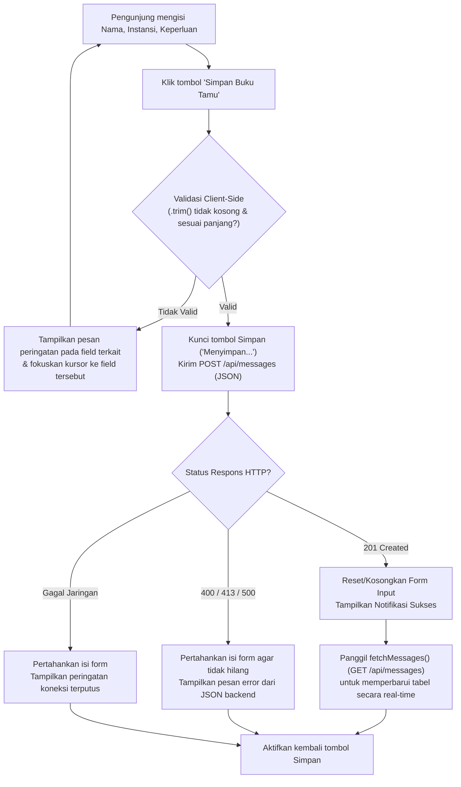
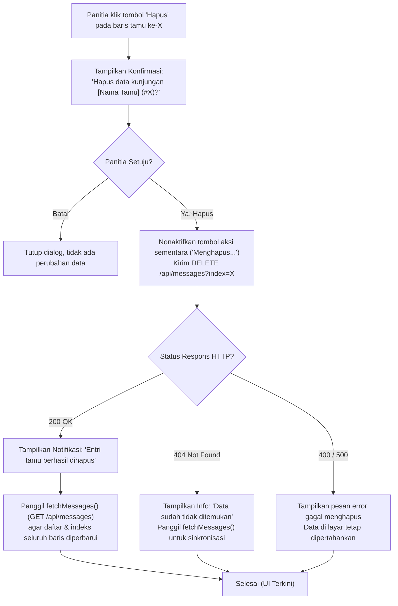
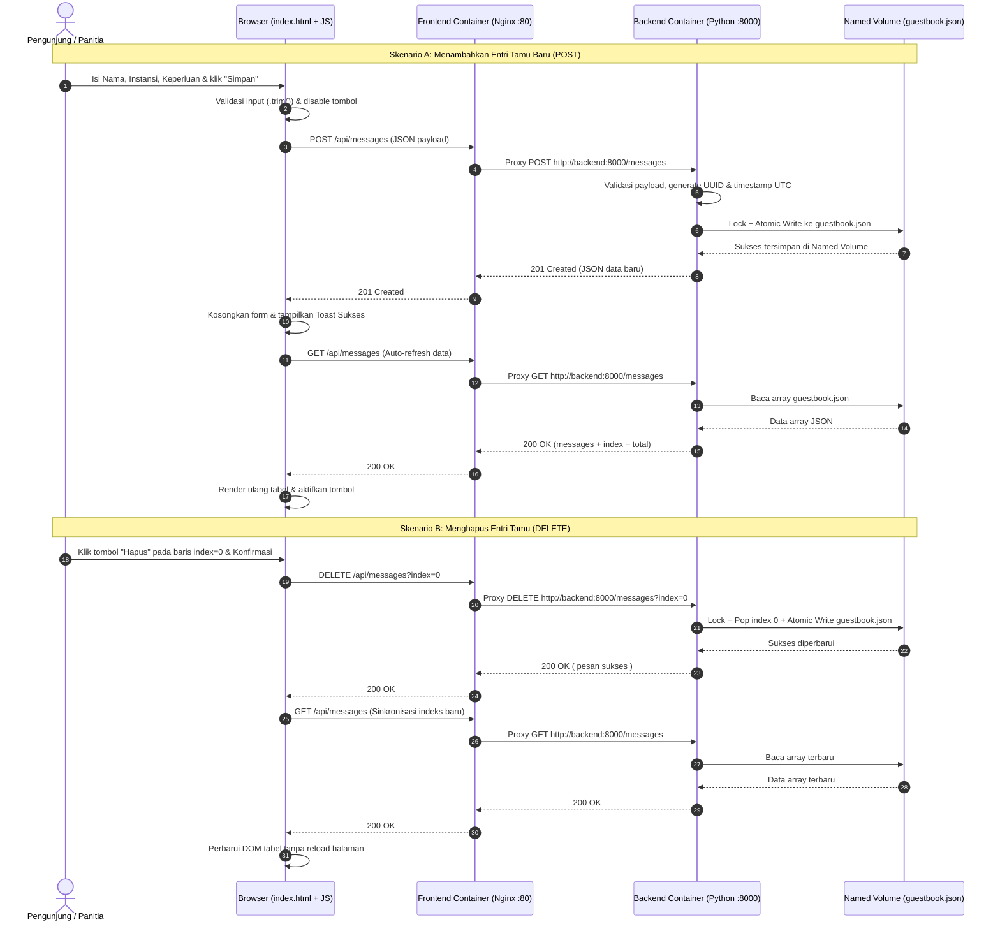
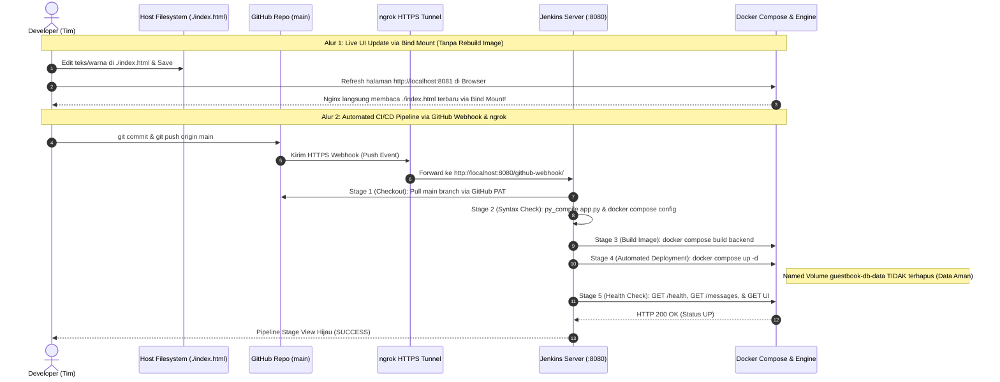

# Dokumentasi User Flow & Desain Interaksi Antarmuka (UI/UX)
## Studi Kasus 1: Buku Tamu Digital Kampus (*Digital Guestbook*)

---

## 1. Gambaran Umum & Prinsip Desain UI/UX

Dokumen ini merancang alur interaksi pengguna (*user flow*), tata letak antarmuka (*wireframe*), manajemen keadaan (*state management*), dan urutan komunikasi asinkron (`fetch()` API) antara halaman **Frontend (`index.html` di Nginx)** dan **Backend (`app.py` di Python)** untuk **Studi Kasus No. 1: Buku Tamu Digital Kampus**.

### Target Kualitas Rubrik Frontend (Bobot 15%)
Berdasarkan **Panduan Ujian Chunin Halaman 3**:
> *"Sangat Baik (85–100): Tampilan UI bersih, `fetch()` JS lancar, tombol Delete berfungsi real-time. Cukup (70–84): UI berfungsi, tetapi pembaruan data harus refresh manual atau async JS belum rapi."*

Untuk memastikan nilai maksimal (85–100), antarmuka dirancang dengan prinsip:
1. **Zero Manual Refresh (SPA-like Reactivity)**: Seluruh aksi tambah (`POST`) dan hapus (`DELETE`) menggunakan `async/await fetch()` yang langsung memperbarui DOM tabel dan kartu statistik secara *real-time* tanpa me-*reload* halaman browser.
2. **Clear Visual Feedback**: Menyediakan indikator *loading*, *toast/banner notification* sukses/gagal, penghitung karakter (*character counter*), dan dialog konfirmasi sebelum menghapus data.
3. **XSS-Safe Rendering**: Seluruh teks dari pengguna dirender menggunakan `textContent` agar aman dari injeksi HTML/script.

---

## 2. Wireframe & Peta Komponen Halaman (`index.html`)

Aplikasi disajikan dalam satu halaman web responsif (*Single-Page Dashboard*) yang menggabungkan **Form Buku Tamu** (untuk Pengunjung) dan **Daftar Hadir Tamu** (untuk Panitia) secara berdampingan:

```text
+-----------------------------------------------------------------------------------+
| [Logo] BUKU TAMU DIGITAL KAMPUS                          [● API Terhubung (UP)]   |
| Sistem Pencatatan Pengunjung Acara & Kegiatan Kampus — Telkom University          |
+-----------------------------------------------------------------------------------+
|  [ Total Tamu Hadir: 12 ]    [ Instansi Terdata: 5 ]    [ Pembaruan: Baru saja ]  |
+-----------------------------------+-----------------------------------------------+
| FORM REGISTRASI TAMU BARU         | DAFTAR PENGUNJUNG TERCATAT      [↻ Muat Ulang]|
| --------------------------------- | --------------------------------------------- |
| Nama Lengkap *          (0/100)   | [Notifikasi Sukses/Error tampil di area ini]  |
| [ Contoh: Budi Santoso          ] |                                               |
|                                   | #0 | Budi Santoso                             |
| Asal Instansi / Kampus * (0/150)  |    | [Telkom University] • 31 Okt 2026, 09:30 |
| [ Contoh: Telkom University/Umum] |    | "Menghadiri Seminar Cloud Computing"     |
|                                   |    |                               [🗑 Hapus] |
| Keperluan Kunjungan *   (0/300)   | --------------------------------------------- |
| [ Contoh: Menghadiri Seminar    ] | #1 | Siti Aminah                              |
| [ Cloud Computing & DevOps      ] |    | [PT Tekno Nusantara] • 31 Okt 2026, 09:45|
|                                   |    | "Kunjungan Industri Laboratorium Cloud"  |
| [      + Simpan Buku Tamu       ] |    |                               [🗑 Hapus] |
+-----------------------------------+-----------------------------------------------+
| Footer: Cloud Computing Chunin Exam • Docker Named Volume & Jenkins CI/CD         |
+-----------------------------------------------------------------------------------+
```

### Daftar Komponen UI Utama
| No | Komponen UI | Fungsi & Perilaku |
|---|---|---|
| **1** | **Header & Status Badge** | Menampilkan identitas aplikasi dan indikator status koneksi ke Backend API (`/api/health`). |
| **2** | **Summary Stats Cards** | Menampilkan *Total Tamu* (`total` dari respons API), *Jumlah Instansi Unik*, dan waktu sinkronisasi terakhir. |
| **3** | **Form Buku Tamu** | Terdiri dari input `name` (maks 100), `institution` (maks 150), `purpose` (maks 300), validasi langsung, dan tombol **Simpan Buku Tamu**. |
| **4** | **Area Notifikasi (Alert/Toast)** | Menampilkan pesan umpan balik sukses (hijau) atau gagal/validasi (merah) disertai ikon status yang jelas. |
| **5** | **Tabel / Kartu Daftar Tamu** | Menampilkan daftar kunjungan beserta nomor indeks (`#0`, `#1`, ...), nama, *badge* instansi, keperluan, waktu lokal, dan tombol **Hapus**. |
| **6** | **Modal Konfirmasi Hapus** | Dialog konfirmasi yang menyebutkan **Nama Tamu** dan **Indeks** sebelum mengeksekusi `DELETE /api/messages?index=X`. |

---

## 3. Master User Flow (Alur Pengguna Keseluruhan)

```mermaid
flowchart TD
    Start(["Pengguna Membuka Browser\nhttp://localhost:8081"]) --> LoadHTML["Nginx menyajikan index.html\n(via Bind Mount dari Host)"]
    LoadHTML --> InitFetch["JS memanggil GET /api/messages\n(Status UI: Loading...)"]
    InitFetch --> CheckGet{"Respons HTTP 200?"}

    CheckGet -->|Tidak / Error| ShowErr["Tampilkan Banner Error Jaringan/Server\n& Tombol 'Coba Lagi'"]
    ShowErr -->|Klik Coba Lagi| InitFetch

    CheckGet -->|Ya (200 OK)| CheckEmpty{"total == 0?"}
    CheckEmpty -->|Ya| RenderEmpty["Tampilkan Empty State:\n'Belum ada tamu yang tercatat'"]
    CheckEmpty -->|Tidak| RenderList["Render Daftar Tamu & Kartu Statistik\nSecara Real-Time di DOM"]

    RenderEmpty --> UserAction{"Aksi Pengguna"}
    RenderList --> UserAction

    UserAction -->|1. Isi Form & Klik Simpan| FlowPost["Sub-Alur: Tambah Tamu Baru\n(POST /api/messages)"]
    UserAction -->|2. Klik Tombol Hapus| FlowDelete["Sub-Alur: Hapus Entri Tamu\n(DELETE /api/messages?index=X)"]
    UserAction -->|3. Klik Tombol Muat Ulang| InitFetch

    FlowPost -->|Sukses 201| RefreshData["Bersihkan Form, Tampilkan Toast Sukses,\n& Panggil Ulang GET /api/messages"]
    FlowDelete -->|Sukses 200 / 404| RefreshData
    RefreshData --> CheckGet
```

---

## 4. Detail Sub-Alur Interaksi per Fitur

### 4.1 Alur Membaca Daftar Tamu (`GET /api/messages`)
1. Saat event `DOMContentLoaded` terpanggil di `index.html`, JavaScript menjalankan fungsi `fetchMessages()`.
2. UI menampilkan indikator *Loading* pada panel daftar tamu.
3. Browser mengirim request `GET /api/messages` ke kontainer Nginx (`:8081`).
4. Nginx meneruskan request tersebut ke `http://backend:8000/messages` melalui *Custom Bridge Network* `app-net`.
5. Backend membaca `/var/lib/backend_data/guestbook.json` dari *Named Volume* `guestbook-db-data`, menambahkan atribut `index` (`0..N-1`), dan mengembalikan JSON `200 OK`.
6. Frontend memperbarui angka pada **Kartu Statistik** dan merender setiap item tamu ke dalam daftar.
   * Waktu `created_at` (UTC ISO 8601) dikonversi menjadi format tanggal & waktu lokal Indonesia menggunakan `Intl.DateTimeFormat('id-ID', ...)` agar mudah dibaca panitia.

### 4.2 Alur Menambahkan Tamu Baru (`POST /api/messages`)


### 4.3 Alur Menghapus Entri Tamu (`DELETE /api/messages?index=X`)


> **Mengapa Wajib Memanggil Ulang `GET` Setelah `DELETE`?**
> Karena penghapusan elemen pada indeks ke-`X` di dalam array `guestbook.json` menyebabkan elemen setelahnya bergeser naik satu posisi (`X+1` menjadi `X`). Dengan memanggil ulang `fetchMessages()` segera setelah `DELETE` berhasil, atribut `data-index` pada setiap tombol **Hapus** di DOM selalu sinkron dengan indeks array terbaru di backend.

---

## 5. Sequence Diagram Komunikasi Komponen

### 5.1 Sequence Diagram: Tambah & Hapus Data secara Real-Time (UI ↔ Nginx ↔ Backend ↔ Named Volume)


### 5.2 Sequence Diagram: Alur DevOps (Bind Mount Live UI & Automated CI/CD Pipeline)
Diagram ini memetakan alur kerja tim pengembang saat mendemonstrasikan **Bind Mount** dan **Automated CI/CD Pipeline (GitHub + ngrok + Jenkins + Docker)** sesuai `ci-cd.jpeg`:



---

## 6. Matriks Keadaan Antarmuka (*UI State Matrix*)

| Keadaan (*State*) | Kondisi Pemicu | Tampilan Visual di Layar | Perilaku Interaksi |
|---|---|---|---|
| **1. Initial Loading** | Halaman baru dibuka, `GET /api/messages` sedang berjalan | Menampilkan indikator *"Memuat daftar tamu kampus..."* | Tombol Hapus belum dirender; tombol Simpan siap. |
| **2. Empty State** | `GET /api/messages` mengembalikan `total: 0` (`messages: []`) | Menampilkan ilustrasi/kotak pesan *"Belum ada tamu terdaftar. Silakan isi formulir di samping."* | Form input aktif dan siap menerima tamu pertama. |
| **3. Populated State** | `GET /api/messages` mengembalikan `total >= 1` | Menampilkan kartu statistik jumlah tamu dan daftar lengkap tamu beserta tombol **Hapus**. | Semua tombol **Hapus** dan **Simpan** aktif. |
| **4. Submitting (`POST`)** | Tombol **Simpan Buku Tamu** diklik & lolos validasi browser | Teks tombol berubah menjadi *"Menyimpan..."* dan berstatus `disabled`. | Mencegah *double-submit* (klik ganda) hingga respons diterima. |
| **5. Deleting (`DELETE`)** | Pengguna menyetujui konfirmasi hapus pada indeks ke-`X` | Tombol Hapus pada baris terkait berubah menjadi *"Menghapus..."* dan seluruh tombol hapus dikunci sementara. | Mencegah dua operasi `DELETE` berjalan bersamaan dengan indeks yang belum disinkronkan. |
| **6. Validation Error** | Input form kosong / melebihi batas karakter (`400`) | Border input berwarna merah dengan pesan spesifik di bawah form/banner. | Isi form **tidak** dihapus agar pengguna cukup memperbaiki bagian yang salah. |
| **7. Server/Network Error** | Backend mati atau mengembalikan `500` | Banner peringatan merah *"Gagal terhubung ke server backend"* disertai tombol **Coba Lagi**. | Indikator status di header berubah menjadi `Offline / Gangguan`. |

---

## 7. Checklist Kepatuhan Demo UTS (Panduan Verifikasi Tim)

Sebelum merekam video demo 5–8 menit, pastikan seluruh daftar periksa berikut telah terpenuhi:
- [x] **UI Bersih & Responsif**: Halaman `index.html` memiliki tampilan rapi, informatif, dan tidak menghasilkan *error* merah pada *Browser Developer Console (F12)*.
- [x] **Async `fetch()` Tanpa Reload**: Menambah tamu (`POST`) dan menghapus tamu (`DELETE`) langsung memperbarui daftar tamu di layar tanpa menekan tombol *Refresh* browser.
- [x] **Bind Mount Berfungsi**: Mengubah judul di `index.html` langsung terlihat saat browser di-*refresh* tanpa menjalankan `docker build`.
- [x] **Data Immunity Terbukti**: Setelah `docker rm -f guestbook-backend` dan `docker compose up -d`, seluruh daftar tamu yang sudah diinput sebelumnya tetap muncul di layar.
- [x] **Auto-Deploy Webhook Berjalan**: Melakukan `git push origin main` otomatis memicu Jenkins melalui *ngrok tunnel* dan menyelesaikan ke-5 *stage* hingga *Health Check* sukses.
