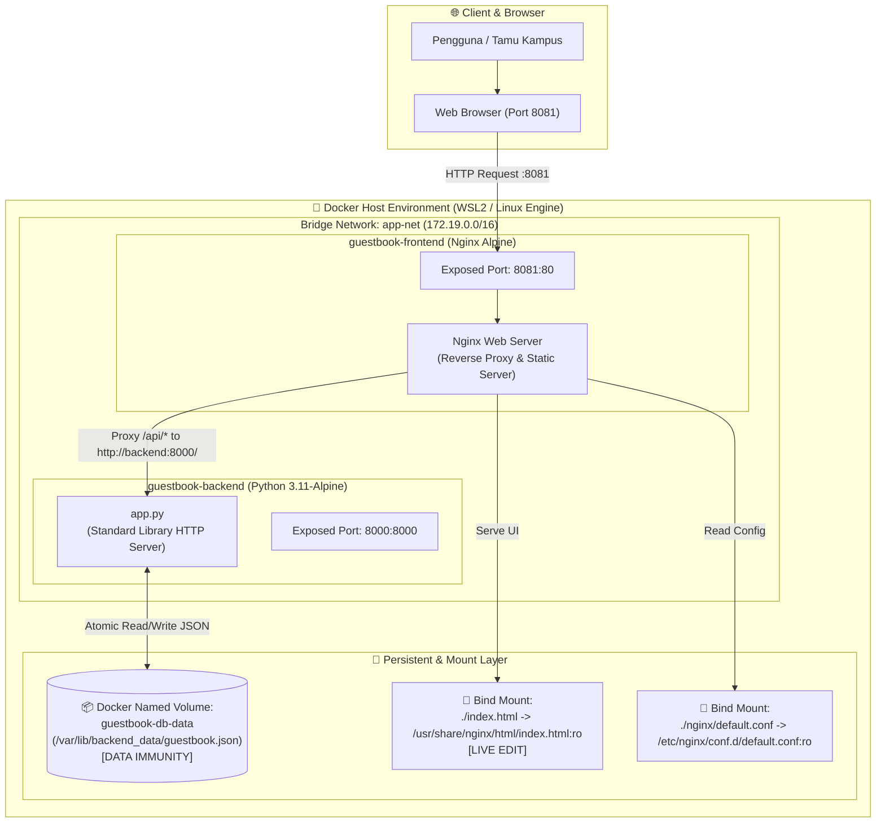
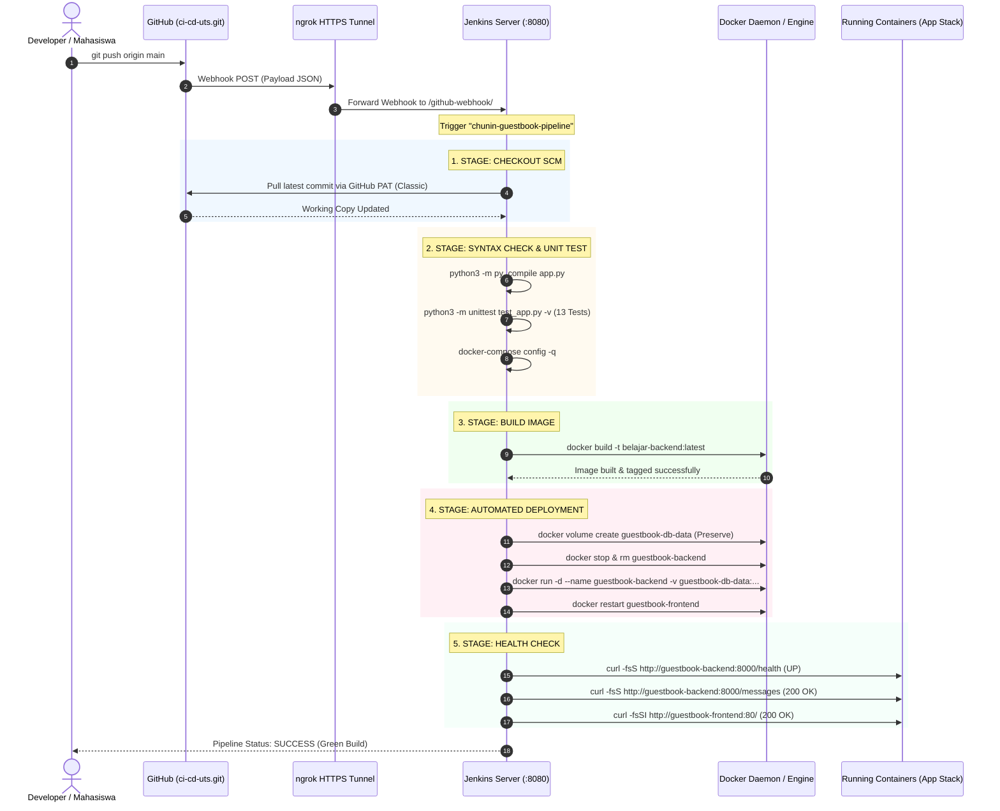

# 🎓 Buku Tamu Digital Kampus (*Digital Guestbook*)
### Ujian Tengah Semester (UTS) — Cloud Computing "Chunin Exam"
**Telkom University** • Semester Ganjil 2024/2025  
**Dosen Pengampu**: Tim Dosen Cloud Computing (CSO)  
**Studi Kasus No. 1**: Buku Tamu Digital Kampus (*Digital Guestbook*)  
**Repositori GitHub**: [https://github.com/ervanfahriaw/ci-cd-uts](https://github.com/ervanfahriaw/ci-cd-uts)

---

## 👥 Identitas Kelompok & Anggota Tim

| No | Nama Lengkap | NIM | Peran / Tanggung Jawab Utama |
|:--:|:---|:---:|:---|
| 1 | **Ervan Fahri A. W.** | *(Isi NIM Anda)* | *Project Lead & DevOps Infrastructure (CI/CD, Webhook, ngrok, Jenkinsfile)* |
| 2 | *(Nama Anggota 2)* | *(NIM Anggota 2)* | *Backend Developer & Storage Specialist (Python REST API & Data Immunity)* |
| 3 | *(Nama Anggota 3)* | *(NIM Anggota 3)* | *Frontend Developer & UI/UX Specialist (Vanilla JS, SITAMU Design, Bind Mount)* |
| 4 | *(Nama Anggota 4)* | *(NIM Anggota 4)* | *QA Engineer, Documentation & Video Presenter (Testing E2E & Recording)* |

> *(Catatan: Silakan sesuaikan daftar anggota di atas dengan tim Anda).*

---

## 📌 Ringkasan Eksekutif Proyek

Proyek ini merupakan implementasi sistem **Buku Tamu Digital Kampus** berbasis arsitektur *Cloud-Native* dan *Containerized Application* yang dilengkapi dengan **Automated CI/CD Pipeline**. Sistem dirancang untuk mencatat kunjungan tamu institusi kampus (tamu akademik, kementerian, industri, dan alumni) secara aman, persisten, dan responsif tanpa *refresh* halaman manual.

### 🌟 Fitur Unggulan & Pemenuhan Rubrik Chunin Exam
1. **Lightweight Python Backend (20%)**: REST API murni menggunakan library standar Python (`http.server`, `json`, `os`, `threading`) tanpa framework berat. Dilengkapi mekanisme *Atomic File Write* dan *Thread Lock* untuk proteksi integritas data, serta validasi ketat (kode status `200`, `201`, `400`, `404`, `413`, `415`, `500`).
2. **SITAMU Telkom University Design (15%)**: Antarmuka web mengadopsi standar desain akademik resmi Telkom University (*Crimson Red `#e01a3f`*, font *Inter* & *Open Sans*, layout *Two-Panel Dashboard*, indikator status koneksi real-time, live character counter, modal dialog konfirmasi hapus, dan proteksi XSS murni).
3. **Data Immunity / Persistensi Data Mutlak (25%)**: Data buku tamu tersimpan di dalam **Docker Named Volume** (`guestbook-db-data`). Terbukti secara empiris: **data tetap utuh 100% meskipun kontainer backend dihancurkan secara paksa (`docker rm -f`)**.
4. **Live Development via Bind Mount (15%)**: Perubahan kode antarmuka pada berkas `index.html` di host langsung ter-update secara instan pada browser tanpa memerlukan proses *build* ulang Docker image.
5. **Full Automated CI/CD Pipeline (25%)**: Otomasi penuh dari `git push` ke GitHub, diteruskan secara *real-time* via **GitHub Webhook** melalui **ngrok HTTPS Tunnel** ke **Jenkins Server**, menjalankan *Declarative 5-Stage Pipeline* (Checkout, Syntax & Unit Test, Build Image, Automated Deployment, Health Check).

---

## 🏛️ Arsitektur Sistem & Container Network

Sistem berjalan di atas kontainer Docker terisolasi yang dihubungkan melalui jaringan kustom *Bridge Network* `app-net`.



### Pemetaan Port & Komponen
| Kontainer | Service | Port Host | Port Kontainer | Tipe Mount | Fungsi |
|---|---|---|---|---|---|
| `guestbook-frontend` | Nginx Alpine | `8081` | `80` | Bind Mount (`./index.html`) | Melayani web UI statis dan reverse proxy `/api/` ke backend |
| `guestbook-backend` | Python 3.11 | `8000` | `8000` | Named Volume (`guestbook-db-data`) | Memproses logika bisnis REST API & penyimpanan persisten |
| `jenkins-server` | Jenkins LTS | `8080` | `8080` | Named Volume (`jenkins_home`) | Automation Server CI/CD Pipeline |

---

## 🔄 Arsitektur Otomatisasi CI/CD Pipeline

Pipeline Jenkins dibangun dengan pendekatan *Declarative Pipeline* yang terdiri dari **5 Stages Wajib** sesuai instruksi ujian chunin.



---

## 🚀 Panduan Menjalankan Proyek di Lingkungan Lokal

### 1. Prasyarat Sistem
- **Docker Engine** (versi 20.10+ atau Docker Desktop / WSL2)
- **Docker Compose** (v2+)
- **Git CLI**
- **Web Browser Modern** (Chrome, Firefox, Edge)

### 2. Kloning Repositori
```bash
git clone https://github.com/ervanfahriaw/ci-cd-uts.git
cd ci-cd-uts
```

### 3. Menjalankan Seluruh Stack via Docker Compose
Jalankan perintah berikut di direktori root proyek:
```bash
docker compose up -d --build
```

Periksa status kontainer:
```bash
docker compose ps
```
*Output yang diharapkan:*
```
NAME                 IMAGE                    STATUS         PORTS
guestbook-backend    belajar-backend:latest   Up             0.0.0.0:8000->8000/tcp
guestbook-frontend   nginx:alpine             Up             0.0.0.0:8081->80/tcp
```

### 4. Mengakses Aplikasi
- **Frontend Web UI**: Buka peramban ke [http://localhost:8081](http://localhost:8081)
- **Backend Health Check**: [http://localhost:8000/health](http://localhost:8000/health) atau melalui reverse proxy di [http://localhost:8081/api/health](http://localhost:8081/api/health)
- **Backend API Messages**: [http://localhost:8000/messages](http://localhost:8000/messages)

### 5. Menghentikan Layanan
```bash
docker compose down
```
*(Catatan: Menjalankan `docker compose down` tanpa flag `-v` akan tetap mempertahankan Named Volume `guestbook-db-data`).*

---

## 📡 Dokumentasi REST API Lengkap

Backend menyediakan antarmuka REST API murni berbasis JSON pada port `8000` (atau via reverse proxy Nginx pada port `8081/api/`).

### Ringkasan Endpoint
| Metode | Endpoint | Deskripsi | Kode Respons Sukses |
|---|---|---|---|
| `GET` | `/health` | Memeriksa ketersediaan server dan volume penyimpanan | `200 OK` |
| `GET` | `/messages` | Mengambil seluruh daftar entri buku tamu secara berurutan | `200 OK` |
| `POST` | `/messages` | Menambahkan catatan buku tamu baru | `201 Created` |
| `DELETE` | `/messages?index=X` | Menghapus catatan tamu pada nomor indeks ke-X | `200 OK` |
| `OPTIONS` | `/messages` | Penanganan *CORS Preflight* untuk peramban | `204 No Content` |

---

### 1. `GET /health`
Memeriksa status operasional backend dan memastikan direktori storage dapat ditulisi (*writable*).

**Response (`200 OK`):**
```json
{
  "status": "UP",
  "service": "guestbook-backend",
  "storage_path": "/var/lib/backend_data/guestbook.json",
  "storage_writable": true,
  "total_entries": 3,
  "timestamp": "2026-10-31T05:20:23Z"
}
```

---

### 2. `GET /messages`
Mengambil semua entri buku tamu. Setiap entri dilengkapi atribut `index` dinamis yang merepresentasikan urutannya di memori/storage.

**Response (`200 OK`):**
```json
{
  "status": "success",
  "total": 2,
  "messages": [
    {
      "id": "8671135a-6c07-4fa5-9c6f-c540d3f549eb",
      "name": "Prof. Adiwijaya",
      "institution": "Telkom University",
      "purpose": "Pembukaan Pameran Cloud dan Inovasi Digital",
      "created_at": "2026-10-31T04:55:01Z",
      "index": 0
    },
    {
      "id": "26802c08-8252-43dd-a957-8f6558ed4689",
      "name": "Siti Nurhaliza",
      "institution": "Kementerian Kominfo",
      "purpose": "Kunjungan Monitoring Laboratorium IoT dan Cloud",
      "created_at": "2026-10-31T04:55:01Z",
      "index": 1
    }
  ]
}
```

---

### 3. `POST /messages`
Menambahkan entri buku tamu baru ke dalam berkas persisten JSON.

**Headers:**
```http
Content-Type: application/json
```

**Request Body:**
```json
{
  "name": "Dr. Ir. Rina Pudjiastuti",
  "institution": "Telkom University",
  "purpose": "Validasi CI/CD Pipeline Jenkins & GitHub Webhook Otomatis"
}
```

**Aturan Validasi Input:**
- `name`: Wajib, tipe string, panjang 1–100 karakter.
- `institution`: Wajib, tipe string, panjang 1–150 karakter.
- `purpose`: Wajib, tipe string, panjang 1–300 karakter.
- Jika ada field kosong/hanya spasi -> Mengembalikan `400 Bad Request`.
- Jika payload melebihi 16 KiB -> Mengembalikan `413 Payload Too Large`.
- Jika `Content-Type` bukan JSON -> Mengembalikan `415 Unsupported Media Type`.

**Response (`201 Created`):**
```json
{
  "status": "success",
  "message": "Entri buku tamu berhasil ditambahkan.",
  "data": {
    "id": "36a88868-638c-4393-9155-9c1a1d6ffbde",
    "name": "Dr. Ir. Rina Pudjiastuti",
    "institution": "Telkom University",
    "purpose": "Validasi CI/CD Pipeline Jenkins & GitHub Webhook Otomatis",
    "created_at": "2026-10-31T05:20:43Z",
    "index": 2
  }
}
```

---

### 4. `DELETE /messages?index=X`
Menghapus catatan buku tamu berdasarkan nomor indeks array (dimulai dari `0`). Setelah penghapusan, urutan indeks elemen yang tersisa akan digeser secara otomatis (*auto-shift*).

**Query Parameters:**
- `index`: Bilangan bulat positif atau nol (`0, 1, 2, ...`).

**Response Sukses (`200 OK`):**
```json
{
  "status": "success",
  "message": "Entri indeks 0 berhasil dihapus.",
  "deleted": {
    "id": "8671135a-6c07-4fa5-9c6f-c540d3f549eb",
    "name": "Prof. Adiwijaya",
    "institution": "Telkom University",
    "purpose": "Pembukaan Pameran Cloud dan Inovasi Digital",
    "created_at": "2026-10-31T04:55:01Z",
    "index": 0
  }
}
```

**Response Error (Indeks tidak ditemukan / `404 Not Found`):**
```json
{
  "status": "error",
  "error": {
    "code": "INDEX_OUT_OF_RANGE",
    "message": "Indeks 99 berada di luar jangkauan data (total entri saat ini: 2)."
  }
}
```

---

## 🛡️ Panduan Pembuktian Uji Data Immunity (Bobot: 25%)

Pengujian ini membuktikan bahwa arsitektur penyimpanan menggunakan **Docker Named Volume** (`guestbook-db-data`) memberikan ketahanan data mutlak (*Immunity*) dari penghancuran kontainer backend.

### Langkah-langkah Pengujian Mandiri:
1. **Tambahkan data tamu** melalui peramban di [http://localhost:8081](http://localhost:8081) atau via terminal:
   ```bash
   curl -X POST http://localhost:8000/messages \
     -H "Content-Type: application/json" \
     -d '{"name":"Prof. Budi Santoso","institution":"Telkom University","purpose":"Uji Ketahanan Data Immunity"}'
   ```
2. **Periksa keberadaan data**:
   ```bash
   curl http://localhost:8000/messages
   ```
3. **Hancurkan kontainer backend secara paksa (*Dismantle*)**:
   ```bash
   docker rm -f guestbook-backend
   ```
   *Verifikasi bahwa kontainer telah musnah*:
   ```bash
   docker ps -a --filter "name=guestbook-backend"
   ```
   *(Tabel kosong membuktikan kontainer telah tiada).*
4. **Buat dan hidupkan kembali kontainer backend**:
   ```bash
   docker compose up -d backend
   ```
5. **Verifikasi data tetap utuh 100%**:
   ```bash
   curl http://localhost:8000/messages
   ```
   *Hasil: Seluruh data yang dimasukkan sebelum kontainer dihancurkan tetap tersimpan utuh tanpa ada satu pun record yang hilang!*

---

## ⚡ Panduan Pembuktian Uji Live Update UI via Bind Mount (Bobot: 15%)

Pengujian ini membuktikan efisiensi alur kerja pengembang di mana file antarmuka statis di-*bind* langsung dari host ke dalam kontainer Nginx.

### Langkah-langkah Pengujian:
1. Buka file `index.html` pada mesin host menggunakan editor teks (VSCode / Notepad).
2. Temukan baris teks judul atau badge di header, misalnya tambahkan teks: `[LIVE UPDATED HOST]`.
3. Simpan perubahan berkas `index.html`.
4. Buka peramban di `http://localhost:8081`, lalu tekan tombol **Refresh (F5)**.
5. Perubahan teks langsung terlihat seketika **tanpa perlu menjalankan `docker build` atau merestart kontainer Nginx**.

---

## ⚙️ Panduan Setup Jenkins CI/CD, PAT & Webhook

Berikut adalah tata cara konfigurasi lengkap integrasi CI/CD dari nol:

### 1. Pembuatan GitHub Personal Access Token (PAT Classic)
1. Buka akun GitHub Anda → **Settings** → **Developer Settings** → **Personal Access Tokens** → **Tokens (classic)**.
2. Klik **Generate new token (classic)**.
3. Beri Note: `Jenkins Chunin Exam UTS`.
4. Centang cakupan perizinan (*scopes*):
   - `[x] repo` (Akses penuh repositori privat/publik)
   - `[x] admin:repo_hook` (Membaca dan menulis webhook repositori)
5. Klik **Generate token**, lalu salin string token (contoh: `ghp_xxxxxxxxxxxx`).

### 2. Konfigurasi Kredensial di Jenkins
1. Buka dashboard Jenkins di `http://localhost:8080`.
2. Masuk ke menu **Manage Jenkins** → **Credentials** → **System** → **Global credentials (unrestricted)**.
3. Klik **Add Credentials**:
   - **Kind**: `Username with password`
   - **Username**: Isi username GitHub Anda (contoh: `ervanfahriaw`)
   - **Password**: Tempelkan GitHub PAT yang baru dibuat
   - **ID**: `github-pat-readonly`
   - **Description**: `GitHub Access Token for CI/CD Webhook`
4. Klik **Create**.

### 3. Membuka Tunnel Publik Menggunakan ngrok
Karena Jenkins berjalan di jaringan lokal (`localhost:8080`), GitHub memerlukan endpoint publik bertaraf HTTPS untuk mengirim *Webhook Push Event*:
```bash
ngrok http 8080
```
Salin URL HTTPS yang dihasilkan, misalnya: `https://subtext-tableful-smashing.ngrok-free.dev`.

### 4. Memasang Webhook di Repositori GitHub
1. Buka repositori proyek di GitHub: `https://github.com/ervanfahriaw/ci-cd-uts`.
2. Klik tab **Settings** → **Webhooks** → **Add webhook**.
3. Masukkan parameter berikut:
   - **Payload URL**: `https://<domain-ngrok-anda>/github-webhook/` *(Wajib diakhiri garis miring `/`)*.
   - **Content type**: `application/json`.
   - **Which events would you like to trigger this webhook?**: Pilih `Just the push event`.
   - **Active**: Pastikan dicentang `[x]`.
4. Klik **Add webhook**. GitHub akan mengirimkan *Ping Event* pertama (pastikan berikon centang hijau / HTTP 200).

### 5. Konfigurasi Pipeline Job di Jenkins
1. Di dashboard Jenkins, klik **New Item**.
2. Masukkan nama: `chunin-guestbook-pipeline`, pilih tipe **Pipeline**, lalu klik **OK**.
3. Pada tab **Build Triggers**, centang:
   - `[x] GitHub hook trigger for GITScm polling`.
4. Pada bagian **Pipeline**:
   - **Definition**: `Pipeline script from SCM`
   - **SCM**: `Git`
   - **Repository URL**: `https://github.com/ervanfahriaw/ci-cd-uts.git`
   - **Credentials**: Pilih `github-pat-readonly`
   - **Branches to build**: `*/main`
   - **Script Path**: `Jenkinsfile`
5. Klik **Save**.

---

## 🎬 Naskah & Panduan Video Demonstrasi (Durasi Pas 5–8 Menit)

> **Ketentuan Ujian Chunin**: Video demo berdurasi **5 hingga 8 menit**, diunggah ke Google Drive / YouTube (Unlisted), dan tautannya disematkan pada pengumpulan tugas.

### Matriks Waktu & Rundown Skenario Perekaman

| Segmen Waktu | Topik Demonstrasi | Aktivitas Layar (*Screen Action*) | Narasi Pembicara (*Speaking Script*) |
|:---:|:---|:---|:---|
| **00:00 – 01:00**<br>*(1 Menit)* | **Pembukaan & Pengenalan Arsitektur** | - Tampilkan slide / README berisi Nama & NIM anggota tim.<br>- Tampilkan diagram arsitektur Docker & CI/CD di README.<br>- Tunjukkan repositori GitHub publik. | *"Halo Bapak/Ibu Dosen Pengampu Cloud Computing. Kami dari kelompok [Nama Kelompok] beranggotakan [Nama & NIM]. Pada video ini kami mempresentasikan solusi Studi Kasus 1: Buku Tamu Digital Kampus berbasis Docker Container dan Automated CI/CD Pipeline Jenkins..."* |
| **01:00 – 02:30**<br>*(1.5 Menit)* | **Demonstrasi Web UI & Operasi CRUD (15% & 20%)** | - Buka browser ke `http://localhost:8081`.<br>- Tunjukkan antarmuka berstandar SITAMU Telkom University.<br>- Isi formulir nama, instansi, keperluan, klik Simpan.<br>- Tunjukkan data bertambah seketika (*Asinkron fetch()*).<br>- Klik tombol Hapus, muncul modal konfirmasi, konfirmasi hapus.<br>- Buka terminal, tunjukkan endpoint `http://localhost:8000/health`. | *"Dapat kita lihat, antarmuka mengadopsi tema resmi Telkom University dengan layout dashboard dua panel. Input form tervalidasi secara ketat dan menggunakan AJAX fetch tanpa refresh halaman. Ketika kita menghapus data, muncul dialog modal konfirmasi dan nomor indeks otomatis tersinkronisasi..."* |
| **02:30 – 03:45**<br>*(1.25 Menit)* | **Uji Live Bind Mount & Uji Data Immunity (25%)** | - Buka `index.html` di VSCode, ganti salah satu teks heading, save.<br>- Refresh browser `http://localhost:8081` (perubahan langsung tampil tanpa build ulang).<br>- Tampilkan daftar tamu saat ini (3 data).<br>- Buka terminal, jalankan `docker rm -f guestbook-backend`.<br>- Tunjukkan kontainer hilang di `docker ps`.<br>- Jalankan `docker compose up -d backend`.<br>- Refresh browser / panggil `GET /messages`. | *"Sekarang kita uji fitur Bind Mount: perubahan file HTML pada host langsung aktif tanpa rebuild image. Selanjutnya, kami buktikan Uji Data Immunity (poin 25%): kami musnahkan kontainer backend dengan 'docker rm -f'. Saat kontainer dinyalakan kembali, seluruh data tamu di Named Volume 'guestbook-db-data' terbukti aman dan utuh 100%!"* |
| **03:45 – 06:15**<br>*(2.5 Menit)* | **Simulasi Otomasi CI/CD Pipeline (25%)** | - Tampilkan dashboard Jenkins & riwayat build sebelumnya.<br>- Tampilkan status ngrok tunnel dan GitHub Webhook (centang hijau).<br>- Buka editor, buat commit baru (misal update deskripsi kecil).<br>- Jalankan `git push origin main`.<br>- Arahkan layar ke dashboard Jenkins: perlihatkan build terpicu otomatis (*webhook poke*).<br>- Perlihatkan eksekusi ke-5 Stage: *Checkout, Syntax Check, Build Image, Automated Deployment, Health Check* hingga status *SUCCESS*. | *"Sekarang mari kita buktikan keandalan CI/CD Pipeline secara otomatis. Kami melakukan commit dan push ke branch main di GitHub. Melalui integrasi GitHub Webhook dan ngrok, Jenkins otomatis mendeteksi push event dan menjalankan pipeline deklaratif 5 stage. Tahap syntax check menguji 13 unit test Python, image baru dibangun, kontainer di-deploy ulang dengan volume persisten, dan diakhiri automated health check dengan status SUCCESS!"* |
| **06:15 – 07:00**<br>*(45 Detik)* | **Kesimpulan & Penutup** | - Tampilkan ringkasan checklist rubrik yang telah terpenuhi 100%.<br>- Tunjukkan kembali status aplikasi live yang sehat. | *"Demikian demonstrasi proyek Buku Tamu Digital Kampus dari kelompok kami. Seluruh aspek arsitektur, persistensi data, reverse proxy, dan otomasi CI/CD telah teruji dan memenuhi 100% kriteria penilaian Chunin Exam. Terima kasih."* |

---

## 📁 Struktur Berkas Proyek

```
BELAJAR/
├── .dockerignore                 # Berkas proteksi build Docker context
├── .gitignore                    # Berkas pengecualian Git
├── Dockerfile                    # Multi-stage image definition untuk backend Python
├── docker-compose.yml            # Orkestrasi multi-kontainer (backend + frontend Nginx)
├── Jenkinsfile                   # Declarative CI/CD Pipeline (5 Stages Wajib)
├── README.md                     # Berkas dokumentasi utama proyek
├── app.py                        # Backend REST API murni (Python standard library)
├── index.html                    # Frontend web UI (SITAMU Telkom University Theme)
├── test_app.py                   # Automated Unit Tests backend (13 skenario uji)
├── docs/                         # Dokumen spesifikasi teknis
│   ├── 01-prd-desain-sistem.md
│   ├── 02-skema-database.md
│   └── 03-user-flow.md
├── design/                       # Desain token dan visual SITAMU
│   ├── DESIGN.md
│   └── code.html
└── nginx/                        # Konfigurasi reverse proxy
    └── default.conf
```

---

## 🏆 Checklist Kesiapan Pengumpulan UTS Chunin

- [x] **Backend API (20%)**: CRUD JSON murni tanpa framework, atomic swap, error code 400/404, dan endpoint `/health`.
- [x] **Frontend Web (15%)**: Desain berstandar tinggi (SITAMU), asinkron `fetch()`, tanpa refresh, XSS safe.
- [x] **Docker & Data Immunity (25%)**: Named Volume `guestbook-db-data` teruji kebal terhadap `docker rm -f`, Bind mount `index.html` live update.
- [x] **Jenkins CI/CD Automation (25%)**: Declarative 5-stage pipeline, GitHub PAT Classic, ngrok HTTPS tunnel, dan Webhook otomatis.
- [x] **Dokumentasi & Video Presentasi (15%)**: `README.md` komprehensif, diagram Mermaid lengkap, dan naskah skenario video 5–8 menit.

---
*Dibuat dengan dedikasi penuh untuk Ujian Tengah Semester (UTS) Cloud Computing — Telkom University.*
