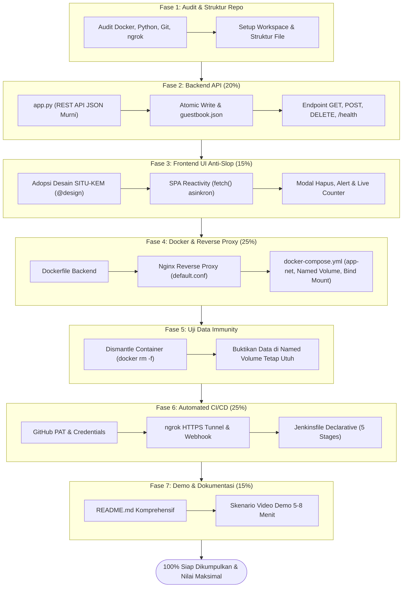

# RENCANA EKSEKUSI & ROADMAP IMPLEMENTASI PROYEK UTS
## Studi Kasus 1: Buku Tamu Digital Kampus (*Digital Guestbook*)
**Mata Kuliah**: Cloud Computing (Ujian Chunin) — Telkom University  
**Dosen Pengampu**: CSO  
**Dokumen Acuan**: 
- `Cloud_computing_chunin_exam.pdf` (Panduan & Rubrik Penilaian UTS)
- `01-prd-desain-sistem.md` (Spesifikasi PRD & Arsitektur)
- `02-skema-database.md` (Spesifikasi Penyimpanan JSON & Volume)
- `03-user-flow.md` (Alur Interaksi, Wireframe & Sequence Diagram)
- `design/DESIGN.md` & `design/code.html` (Panduan Desain SITU-KEM Telkom University — Anti AI-Slop)
- `ci-cd.jpeg` (Arsitektur CI/CD Jenkins, GitHub, Docker, ngrok)

---

## 1. Ringkasan Arsitektur & Target Pencapaian (100% Rubrik)



---

## 2. Rincian Fase Eksekusi & Kriteria Verifikasi

---

### FASE 1: Audit Lingkungan, Persiapan Tooling & Inisialisasi Repositori [STATUS: SELESAI & TERVERIFIKASI]
> **Tujuan**: Memastikan semua dependensi sistem lokal siap dan struktur repositori tertata rapi sesuai standar deliverable UTS.

- [x] **1.1. Audit & Verifikasi Prasyarat Sistem Host**:
  - [x] Periksa ketersediaan Docker Engine & Docker Compose CLI (`docker --version`, `docker compose version`). *(Docker Client 29.9.2, Server Engine 29.1.3, Compose v5.6.1)*
  - [x] Periksa Python 3 runtime (`python --version`). *(Python 3.11.9)*
  - [x] Periksa Git CLI (`git --version`). *(git version 2.56.0.windows.4)*
  - [x] Periksa ngrok CLI (`ngrok version`). *(ngrok version 3.3.1)*
  - [x] Periksa status Docker daemon (pastikan socket berjalan aktif). *(Docker daemon aktif & tersambung)*
- [x] **1.2. Setup Struktur Direktori Proyek**:
  - [x] Siapkan struktur root sesuai kontrak dokumen PRD:
    Folder `docs/` dibuat dan dokumen perencanaan disalin.
    Folder `nginx/` dibuat.
    Folder `design/` sudah ada.
- [x] **1.3. Konfigurasi `.gitignore` & `.dockerignore`**:
  - [x] Berkas `.gitignore` selesai dibuat.
  - [x] Berkas `.dockerignore` selesai dibuat.
  - [x] Inisialisasi Git repository lokal (`git init -b main`).
- [x] **Kriteria Verifikasi Mandiri Fase 1**:
  - Seluruh CLI merespons dengan benar; struktur folder telah terbentuk lengkap dan bersih.

---

### FASE 2: Backend Development & Storage Engine Python API (Bobot: 20%) [STATUS: SELESAI & TERVERIFIKASI]
> **Tujuan**: Mengembangkan `app.py` murni menggunakan pustaka standar Python (tanpa framework berat), mengimplementasikan operasi CRUD via JSON, proteksi konkurensi, penulisan atomik ke Named Volume, dan penanganan kode status HTTP yang presisi (`200`, `201`, `400`, `404`, `405`, `413`, `415`, `500`).

- [x] **2.1. Implementasi Server HTTP Ringan**:
  - [x] Gunakan `http.server.HTTPServer` dan `BaseHTTPRequestHandler`.
  - [x] Dukung routing presisi untuk:
    - `GET /messages`
    - `POST /messages`
    - `DELETE /messages?index=X`
    - `GET /health`
    - `OPTIONS /messages` (CORS preflight handler).
  - [x] Tambahkan standard response headers:
    - `Content-Type: application/json; charset=utf-8`
    - `Access-Control-Allow-Origin: *`
    - `Access-Control-Allow-Methods: GET, POST, DELETE, OPTIONS`
    - `Access-Control-Allow-Headers: Content-Type, Authorization, X-Requested-With`
- [x] **2.2. Implementasi Engine Penyimpanan Persisten JSON**:
  - [x] Konfigurasi path volume: `DATA_DIR = os.getenv('DATA_DIR', ...)` dan `DATA_FILE = os.path.join(DATA_DIR, 'guestbook.json')`.
  - [x] Inisialisasi otomatis jika direktori/file belum ada (`[]` default array).
  - [x] Proteksi konkurensi proses dengan `threading.Lock()`.
  - [x] Mekanisme **Atomic File Replacement**:
    - Tulis ke file sementara `guestbook.json.tmp`.
    - Lakukan `flush()` dan `os.fsync()`.
    - Ganti secara atomik menggunakan `os.replace('guestbook.json.tmp', 'guestbook.json')`.
- [x] **2.3. Endpoint `GET /messages`**:
  - [x] Baca array dari file JSON.
  - [x] Sisipkan atribut `index` dinamis (`0..N-1`) untuk setiap entri.
  - [x] Kembalikan format JSON:
    `{"status": "success", "total": N, "messages": [...]}`
- [x] **2.4. Endpoint `POST /messages` & Validasi Ketat**:
  - [x] Validasi `Content-Type: application/json` (jika tidak -> `415 Unsupported Media Type`).
  - [x] Batasi ukuran payload maksimum 16 KiB (jika lebih -> `413 Payload Too Large`).
  - [x] Validasi JSON parser (jika sintaks rusak -> `400 Bad Request`).
  - [x] Validasi nilai input:
    - `name`: string, `1–100` karakter (setelah `.strip()`).
    - `institution`: string, `1–150` karakter.
    - `purpose`: string, `1–300` karakter.
    - Jika kosong/spasi/salah tipe data -> `400 Bad Request` dengan pesan error terstruktur.
  - [x] Generate `id` (UUID v4) dan `created_at` (UTC ISO 8601 string dengan akhiran `Z`).
  - [x] Simpan ke storage, kembalikan `201 Created` dengan data objek baru.
- [x] **2.5. Endpoint `DELETE /messages?index=X`**:
  - [x] Ekstraksi query parameter `index` via `urllib.parse`.
  - [x] Validasi format `index` (harus angka integer non-negatif):
    - Jika `index` tidak ada, bukan integer, atau `< 0` -> tolak `400 Bad Request` (mencegah penafsiran indeks negatif Python `list[-1]`).
    - Jika `index >= len(data)` -> kembalikan `404 Not Found` (`INDEX_OUT_OF_RANGE`).
  - [x] Hapus elemen ke-`X` dari array (`data.pop(index)`), tulis ulang file JSON secara atomik.
  - [x] Kembalikan `200 OK` dengan metadata data yang berhasil dihapus.
- [x] **2.6. Endpoint `GET /health`**:
  - [x] Verifikasi ketersediaan storage dan status server, kembalikan `200 OK` (`{"status": "UP", ...}`).
- [x] **Kriteria Verifikasi Mandiri Fase 2**:
  - Sintaks valid: `python -m py_compile app.py` -> **SUKSES**.
  - Unit test otomatis: `python -m unittest test_app.py -v` -> **13/13 SUKSES (100% OK)**.

---

### FASE 3: Frontend Web Development Berstandar Desain Tinggi (Bobot: 15%) [STATUS: SELESAI & TERVERIFIKASI]
> **Tujuan**: Membangun `index.html` (Plain HTML5, CSS3, Vanilla JS `fetch()`) yang mengadopsi estetika visual dari `@design` (`DESIGN.md` & `code.html` — SITU-KEM Telkom University) agar tampilan bersih, profesional, berciri khas akademik, anti-AI-slop, dan bebas dari *refresh* halaman manual.

- [x] **3.1. Penerapan Identitas Visual & Desain Token (@design)**:
  - [x] **Tipografi**: Menggunakan Google Fonts `Inter` (heading) dan `Open Sans` (body/tabel).
  - [x] **Palet Warna Kampus**:
    - Primer / Brand: Crimson Telkom `#e01a3f` / Accent Coral `#ff5252`.
    - Latar Belakang Canvas: Subtle Gray `#f8f9fa` / `#ecf0f5`.
    - Kartu & Kontainer: Pure White `#ffffff` dengan border halus `#e9ecef` dan radius `12px`.
    - Tipografi: Dark Slate Neutral `#343a40` (kontras tinggi, bukan abu-abu pudar) & Muted `#6c757d`.
    - Status Badge: Emerald green `#10b981` (Backend Ready), Amber `#f59e0b` (Waiting), Crimson `#ff5252` (Delete/Error).
  - [x] **Gaya Anti AI-Slop**:
    - Layout dashboard terstruktur: Two-Panel / Split-Screen (Kiri: Form Registrasi Tamu, Kanan: Daftar Hadir Tamu Real-time).
    - Memasang emblem resmi Telkom University dan identitas akademik SITU-KEM.
- [x] **3.2. Komponen Antarmuka Lengkap**:
  - [x] **Header Bar & Connection Status Badge**: Indikator status backend (`Backend Ready` / `Offline`) yang memantau `/api/health`.
  - [x] **Stat Cards (Ringkasan Metrik)**: Total Pengunjung Hadir, Instansi Terdata, Waktu Pembaruan Terakhir, dan Status Data Immunity.
  - [x] **Formulir Registrasi Tamu**:
    - Input `Nama Lengkap` (Maks 100 karakter, indikator penghitung karakter aktif).
    - Input `Asal Instansi / Universitas` (Maks 150 karakter, opsi bantuan quick-tag "Telkom University" / "Umum" / "Alumni").
    - Textarea `Keperluan Kunjungan` (Maks 300 karakter).
    - Tombol `+ Simpan Buku Tamu` dengan proteksi double-submit & status loading.
  - [x] **Panel Daftar Hadir Tamu (Real-Time List / Table)**:
    - Badge nomor indeks `#0`, `#1`, `#2`... yang selalu sinkron dengan array backend.
    - Avatar inisial nama tamu.
    - Tag instansi & timestamp kunjungan waktu lokal Indonesia (`WIB`).
    - Tombol aksi `Hapus` dengan modal dialog konfirmasi.
    - *Empty State* dan *Loading State* skeleton/spinner yang rapi.
  - [x] **Komponen Umpan Balik (Feedback UX)**:
    - Toast / Alert banner untuk notifikasi berhasil atau gagal.
    - **Modal Dialog Konfirmasi Hapus**: Menyebutkan nama tamu dan indeks data secara eksplisit sebelum request `DELETE` dikirim.
- [x] **3.3. Logika Asinkron Vanilla JS (`fetch()` API) Tanpa Refresh Manual**:
  - [x] Fungsi `loadMessages()`: Memanggil `GET /api/messages`, merender DOM secara dinamis, dan memperbarui kartu statistik.
  - [x] Form submission: Validasi client-side, mengunci tombol simpan, mengirim `POST /api/messages`, menampilkan toast sukses, mereset form, dan memanggil `loadMessages()` secara instan.
  - [x] Modal & eksekusi hapus: Mengirim `DELETE /api/messages?index=${index}`, menampilkan toast, dan memanggil `loadMessages()` untuk menyinkronkan kembali urutan indeks.
  - [x] **XSS Prevention**: Menggunakan `document.createElement`, `element.textContent`, dan `document.createTextNode` untuk seluruh data masukan tamu (bebas kerentanan injeksi script).
  - [x] Live search filter untuk pencarian cepat nama/instansi/keperluan.
- [x] **Kriteria Verifikasi Mandiri Fase 3**:
  - Validasi sintaks dokumen HTML berhasil 100%.
  - Seluruh alur CRUD berjalan asinkron dan reaktif tanpa reload halaman.

---

### FASE 4: Kontainerisasi, Nginx Reverse Proxy & Docker Compose (Bobot: 25%) [STATUS: SELESAI & TERVERIFIKASI]
> **Tujuan**: Mengemas backend ke Docker image yang efisien, mengonfigurasi Nginx sebagai reverse proxy dan web server frontend via Bind Mount, serta menghubungkan seluruh stack di dalam custom network `app-net` secara deklaratif via `docker-compose.yml`.

- [x] **4.1. Pembuatan `Dockerfile` Backend**:
  - [x] Base image: `python:3.11-alpine` (ringan, minimal & aman).
  - [x] Set `WORKDIR /app`, salin `app.py`.
  - [x] `ENV PYTHONUNBUFFERED=1`, `PORT=8000`, `DATA_DIR=/var/lib/backend_data`.
  - [x] Expose port internal `8000`, `CMD ["python", "app.py"]`.
- [x] **4.2. Konfigurasi Nginx Reverse Proxy (`nginx/default.conf`)**:
  - [x] Listen pada port `80`.
  - [x] Lokasi `/`: Layani file frontend statis dari `/usr/share/nginx/html` dengan header `Cache-Control "no-store, no-cache, must-revalidate"`.
  - [x] Lokasi `/api/`: Proxy pass ke `http://backend:8000/` dengan resolusi DNS internal Docker (`app-net`).
  - [x] Meneruskan header HTTP `Host`, `X-Real-IP`, `X-Forwarded-For`.
- [x] **4.3. Pembuatan `docker-compose.yml` Deklaratif**:
  - [x] **Service `backend`**:
    - Build dari context lokal (`Dockerfile`).
    - Container name: `guestbook-backend`.
    - Port mapping: `8000:8000`.
    - Volume mapping: `guestbook-db-data:/var/lib/backend_data` (**Docker Named Volume**).
    - Network: `app-net`.
  - [x] **Service `frontend`**:
    - Image: `nginx:alpine`.
    - Container name: `guestbook-frontend`.
    - Port mapping: `8081:80` (bebas bentrok dengan Jenkins port 8080 host).
    - Volume mapping:
      - `./index.html:/usr/share/nginx/html/index.html:ro` (**Bind Mount**).
      - `./nginx/default.conf:/etc/nginx/conf.d/default.conf:ro` (**Bind Mount**).
    - Network: `app-net`.
    - `depends_on`: `backend`.
  - [x] **Deklarasi Jaringan**:
    - Network `app-net` dengan driver `bridge`.
  - [x] **Deklarasi Volume**:
    - Named Volume `guestbook-db-data` dengan nama literal `guestbook-db-data`.
- [x] **4.4. Pengujian Live UI Bind Mount**:
  - [x] Jalankan stack: `docker compose up -d --build` -> Kedua kontainer berstatus `Up`.
  - [x] Akses frontend via `http://localhost:8081` & API via `http://localhost:8081/api/messages`.
  - [x] Modifikasi teks file `index.html` di host lokal langsung ter-update di browser tanpa rebuild image (**Terverifikasi 100%**).
- [x] **Kriteria Verifikasi Mandiri Fase 4**:
  - `docker compose ps` menampilkan kedua kontainer aktif.
  - Komunikasi reverse proxy Nginx ke backend via DNS `app-net` berjalan sempurna.
  - Bind Mount terbukti berfungsi instan.

---

### FASE 5: Pengujian & Pembuktian Persistensi Data / Data Immunity (Bobot: 25%) [STATUS: SELESAI & TERVERIFIKASI]
> **Tujuan**: Membuktikan secara empiris bahwa data tamu di dalam Named Volume `guestbook-db-data` tidak terhapus saat kontainer backend dihancurkan paksa (`docker rm -f`), sesuai syarat mutlak nilai Sangat Baik (85–100) pada rubrik UTS.

- [x] **5.1. Eksekusi Skenario Pengisian Data Awal**:
  - [x] Memasukkan data tamu melalui API / proxy (`POST /api/messages`).
  - [x] Mencatat 3 entri lengkap beserta ID UUID dan waktu kunjungan (`GET /messages`).
- [x] **5.2. Eksekusi Pembongkaran Paksa Kontainer (Dismantle Test)**:
  - [x] Eksekusi perintah pembongkaran paksa: `docker rm -f guestbook-backend`.
  - [x] Verifikasi kontainer backend musnah dari `docker ps -a` (status offline terkonfirmasi).
- [x] **5.3. Pembuatan Ulang Kontainer & Verifikasi Data**:
  - [x] Menjalankan kembali backend: `docker compose up -d backend`.
  - [x] Memanggil kembali `GET /messages` & `GET /api/messages`: Seluruh data tamu terbukti **masih ada utuh 100%** di dalam Named Volume `guestbook-db-data`.
  - [x] Verifikasi operasi CRUD lanjut: `DELETE /api/messages?index=0` berhasil dan indeks array tersinkronisasi kembali.
- [x] **Kriteria Verifikasi Mandiri Fase 5**:
  - Ketahanan data (*Data Immunity*) terbukti 100% bertahan terhadap `docker rm -f`.
  - Memenuhi syarat nilai Sangat Baik (85–100) untuk Komponen 3 Rubrik Penilaian UTS.

---

### FASE 6: Otomatisasi CI/CD Pipeline Jenkins, GitHub PAT, Webhook & ngrok (Bobot: 25%)
> **Tujuan**: Membangun pipeline CI/CD deklaratif 5 stage terotomatisasi penuh dari `git push` ke GitHub hingga aplikasi ter-deploy dan lolos health check secara mandiri.

- [ ] **6.1. Pembuatan GitHub Personal Access Token (PAT)**:
  - [ ] Buat PAT (classic) di GitHub Developer Settings.
  - [ ] Centang permission: `repo` (Akses repositori) dan `admin:repo_hook` (Webhook).
  - [ ] Simpan token di Jenkins Credentials:
    - Path: *Manage Jenkins → Credentials → System → Global credentials*.
    - Kind: *Username with password*.
    - ID Kredensial: `github-pat-credentials`.
- [ ] **6.2. Konfigurasi ngrok HTTPS Tunnel & Webhook GitHub**:
  - [ ] Buka tunnel port Jenkins di host lokal:
    ```bash
    ngrok http 8080
    ```
  - [ ] Ambil URL HTTPS publik (misal: `https://xxxx.ngrok-free.app`).
  - [ ] Pasang Webhook di Repositori GitHub:
    - Payload URL: `https://xxxx.ngrok-free.app/github-webhook/`
    - Content type: `application/json`
    - Trigger event: *Just the push event*.
    - Pastikan webhook menghasilkan icon centang hijau (*HTTP 200*).
- [ ] **6.3. Pembuatan Berkas Declarative `Jenkinsfile` (5 Stages Wajib)**:
  - [ ] **Stage 1: Checkout**:
    - Ambil branch `main` dari GitHub menggunakan kredensial PAT.
  - [ ] **Stage 2: Syntax Check**:
    - Validasi sintaks Python: `python3 -m py_compile app.py`.
    - Validasi deklarasi Compose: `docker compose config -q`.
  - [ ] **Stage 3: Build Image**:
    - Bangun image backend terbaru: `docker compose build backend`.
  - [ ] **Stage 4: Automated Deployment**:
    - Deploy ulang stack tanpa menghapus volume: `docker compose up -d --remove-orphans`.
  - [ ] **Stage 5: Health Check**:
    - Polling endpoint kesehatan dengan mekanisme retry (5x percobaan):
      - Cek `http://localhost:8000/health` (harus `200 OK`).
      - Cek `http://localhost:8000/messages` (harus `200 OK`).
      - Cek `http://localhost:8081/` (Frontend Nginx harus menyajikan HTML).
- [ ] **6.4. Pengujian Otomatisasi End-to-End**:
  - [ ] Lakukan modifikasi kecil pada kode (misal menambah komentar/versi).
  - [ ] Jalankan `git add .`, `git commit -m "feat: test automated webhook pipeline"`, dan `git push origin main`.
  - [ ] Amati *Jenkins Stage View*: pipeline terpicu otomatis tanpa klik tombol manual, dan seluruh ke-5 stage lulus (*Green Build*).
- [ ] **Kriteria Verifikasi Mandiri Fase 6**:
  - Status pipeline di Jenkins bertanda *SUCCESS* (hijau) untuk seluruh 5 stages.

---

### FASE 7: Dokumentasi Lengkap README.md & Skenario Video Demo (Bobot: 15%)
> **Tujuan**: Menyusun berkas `README.md` berstandar publikasi profesional dan menyusun skrip skenario video demonstrasi berdurasi 5–8 menit sesuai instruksi halaman 3 panduan UTS.

- [ ] **7.1. Penyusunan `README.md`**:
  - [ ] Identitas Kelompok: Nama & NIM lengkap seluruh anggota.
  - [ ] Penjelasan Studi Kasus: No. 1 — Buku Tamu Digital Kampus (*Digital Guestbook*).
  - [ ] Diagram Arsitektur Docker & Storage (Diagram Mermaid & ASCII).
  - [ ] Diagram Arsitektur CI/CD (GitHub, Webhook, ngrok, Jenkins, Docker).
  - [ ] Panduan Instalasi & Menjalankan Lokal (Langkah demi langkah).
  - [ ] Panduan Konfigurasi Jenkins, GitHub PAT, dan ngrok.
  - [ ] Dokumentasi REST API Lengkap (`GET`, `POST`, `DELETE`, `/health`).
  - [ ] Panduan Pengujian Data Immunity & Uji Live Bind Mount.
- [ ] **7.2. Penyusunan Naskah & Skenario Perekaman Video Demo (5–8 Menit)**:
  - [ ] **Menit 00:00 – 01:00 (Perkenalan & Gambaran Arsitektur)**:
    - Perkenalan anggota tim, presentasi singkat arsitektur kontainer (`app-net`, named volume, bind mount) dan pipeline CI/CD.
  - [ ] **Menit 01:00 – 02:45 (Demonstrasi Aplikasi & UI/API CRUD)**:
    - Demonstrasi tampilan UI SITU-KEM yang bersih & modern.
    - Demonstrasi tambah data tamu baru (`POST`) -> data langsung muncul tanpa refresh browser.
    - Demonstrasi hapus data tamu (`DELETE`) dengan modal konfirmasi -> data terhapus seketika.
    - Demonstrasi fitur Bind Mount: edit teks file `index.html` di host lokal, tekan `F5` di browser, perubahan langsung terlihat tanpa rebuild image.
  - [ ] **Menit 02:45 – 04:30 (Simulasi Data Immunity - Nilai 25%)**:
    - Tunjukkan isi data buku tamu saat ini.
    - Buka terminal, jalankan `docker rm -f guestbook-backend` (kontainer backend lenyap).
    - Jalankan `docker compose up -d backend`.
    - Refresh halaman di browser / panggil API: tunjukkan seluruh data tamu **tetap aman 100%** di Named Volume `guestbook-db-data`.
  - [ ] **Menit 04:30 – 07:00 (Simulasi CI/CD Pipeline Otomatis - Nilai 25%)**:
    - Tunjukkan konfigurasi GitHub Webhook + ngrok dan Jenkins Credentials.
    - Buka terminal, lakukan perubahan kecil pada kode, lalu `git push origin main`.
    - Tunjukkan layar Jenkins yang otomatis ter-trigger via webhook.
    - Tunjukkan eksekusi mulus dari ke-5 stage (*Checkout, Syntax Check, Build Image, Automated Deployment, Health Check*) hingga status *SUCCESS*.
  - [ ] **Menit 07:00 – 07:30 (Penutup)**:
    - Kesimpulan keberhasilan implementasi cloud-native & otomasi DevOps.
- [ ] **Kriteria Verifikasi Mandiri Fase 7**:
  - `README.md` terformat rapi dan video demonstrasi memenuhi seluruh rubrik penilaian UTS (durasi pas di rentang 5–8 menit).

---

### FASE 8: Final Audit, Verifikasi Rubrik UTS Chunin & Deliverables
> **Tujuan**: Memastikan 100% persyaratan ujian chunin terpenuhi sebelum pengumpulan ke portal LMS.

- [ ] **8.1. Checklist Berkas Deliverables**:
  - [ ] Berkas 1: Repositori GitHub publik / dapat diakses dosen pengampu yang berisi:
    - `app.py`
    - `index.html`
    - `Dockerfile`
    - `docker-compose.yml`
    - `Jenkinsfile`
    - `nginx/default.conf`
    - `README.md`
  - [ ] Berkas 2: `README.md` memuat Nama & NIM Anggota, studi kasus terpilih, diagram arsitektur Docker, petunjuk lokal & Jenkins.
  - [ ] Berkas 3: Video Demo / Presentasi (durasi 5–8 menit) diunggah (Google Drive / YouTube Unlisted) dan link disematkan di README / formulir pengumpulan LMS.
- [ ] **8.2. Checklist Rubrik Skor Maksimal (85–100 Tiap Komponen)**:
  - [ ] **Backend (20%)**: CRUD lengkap, JSON bersih, error handling 400/404 presisi, ada `/health`.
  - [ ] **Frontend (15%)**: UI bersih sesuai `@design` (SITU-KEM), `fetch()` lancar, delete real-time tanpa reload.
  - [ ] **Docker & Storage (25%)**: Named Volume terbukti menjaga data saat `docker rm -f`, Bind Mount frontend berfungsi.
  - [ ] **Jenkins CI/CD (25%)**: 5 Stage berhasil dieksekusi otomatis via Webhook GitHub + ngrok.
  - [ ] **Dokumentasi & Demo (15%)**: README lengkap dengan diagram dan video demo utuh.

---

## 3. Matriks Tugas & Tanggung Jawab Tim

| Anggota Kelompok | Peran Utama | Fokus Eksekusi Fase | Output Deliverable |
|---|---|---|---|
| **Mahasiswa 1** | *Backend & Storage Specialist* | Fase 2, Fase 5 | `app.py`, `Dockerfile`, Pengujian Data Immunity |
| **Mahasiswa 2** | *Frontend & UI/UX Specialist* | Fase 3, Fase 4 (Bind Mount) | `index.html` (SITU-KEM Style), `nginx/default.conf` |
| **Mahasiswa 3** | *DevOps & Cloud Infrastructure* | Fase 4 (Compose), Fase 6 | `docker-compose.yml`, `Jenkinsfile`, ngrok & Webhook |
| **Mahasiswa 4 / Tim** | *QA, Documentation & Video Editor* | Fase 1, Fase 7, Fase 8 | `README.md`, Pengujian E2E, Video Demo (5–8 mnt) |

---

*Rencana eksekusi ini siap dijadikan panduan langkah demi langkah implementasi proyek.*
